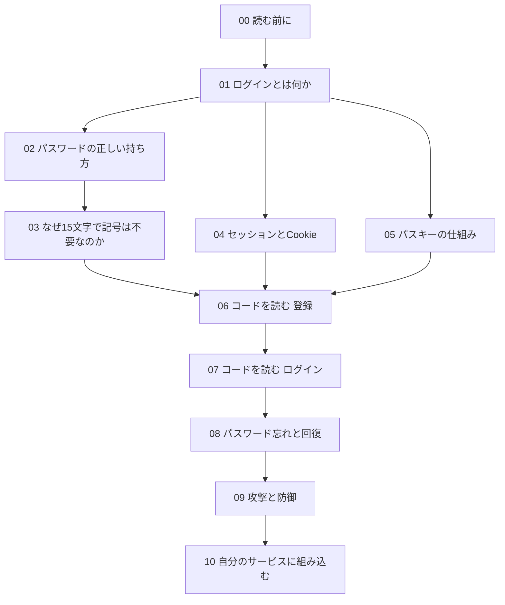

# 00 読む前に

この解説は、passkey-auth-starter（パスキー・オース・スターター）という「ログイン機能の見本」を題材に、
**ログインの仕組みが何を守るために、どう作られているか**を説明するものです。

想定している読み手は次の 2 種類の人です。

- プログラムを書き始めたばかりで、「ログイン機能はライブラリに任せればいい」と思っているが、中で何が起きているかは知らない人
- システムを発注する側で、見積もりや受け入れのときに「この会社の作るログインは大丈夫か」を判断したい人

コードを 1 行も書かない人でも読めるように、各章は「なぜそうするのか」を先に、「どうやるのか」を後に書いています。

## この解説の約束

### 1. 専門用語は、初めて出てきたところで一文で説明する

たとえば「ハッシュ（元に戻せない変換）」のように、かっこの中に短い説明を付けます。
2 回目からは説明を付けません。分からない言葉が出てきたら、その言葉が最初に出てきた章を探してください。

### 2. 「なぜ」を先に書く

ログインの作り方には「こう書くべき」という決まりごとがたくさんあります。
決まりだけを覚えると、少し違う場面で応用が効きません。そこで、各章は「どんな攻撃を想定しているか」「何が起きると困るか」から始めます。

### 3. 「完全に安全」とは書かない

どんな仕組みにも限界があります。この解説では「防ぐ」を「成功しにくくする」という意味で使い、
防げないもの（残るリスク）があれば、そのことも書きます。残るリスクの一覧は `docs/threat-model.md` にもまとめてあります。

### 4. コードは実物から引用する

コードの抜粋は、このリポジトリ（GitHub 上で公開しているソースコード一式の置き場）の実際のファイルから取っています。
抜粋の 1 行目には、次のように「どのファイルの何行目か」を書いています。

```ts
// 出典: src/auth/password.ts:8-9
// S2: NIST SP 800-63B-4 は「パスワードだけで使うなら 15 文字以上」を求める。
export const MIN_PASSWORD_LENGTH = 15;
```

途中を省いたところには `// …（略）` と書きます。行番号はこの解説を書いた時点のものです。
コードを直して引用とずれると、自動テスト（`test/unit/guide.test.ts`）が失敗して気づけるようにしてあります。

### 5. S1〜S13 は設計書の番号

コードのコメントや本文に出てくる「S7」などの記号は、設計書（`docs/design.md`）§6 の**セキュリティ要件の番号**です。
たとえば S7 は「セッション ID は 256bit 乱数、Cookie は HttpOnly + SameSite=Lax + Secure」という要件です。
「この行はどの要件を満たすために書かれたのか」をたどれるように、番号をそろえて書いています。

## 章の地図



- **考え方の章（01〜05）**: コードをほとんど読まずに、仕組みの理由を説明します。発注側の方はここまで読めば十分です。
- **コードを読む章（06〜08）**: 実際のファイルを上から順に読みます。
- **まとめの章（09〜10）**: 攻撃ごとに「どの行が防いでいるか」を振り返り、自分のサービスに使うときの注意をまとめます。

## 手元で動かしながら読む

読みながら実際に動かすと、理解が早くなります。必要なのは Node.js（ノード・ジェイエス。ブラウザの外で JavaScript を動かす実行環境）の 22.12 以降と Git だけです。

```bash
git clone https://github.com/h-kawanishi/passkey-auth-starter.git
cd passkey-auth-starter
npm install
cp .env.example .env
npm run dev
# ログに http://127.0.0.1:3000 と出たら、http://localhost:3000 をブラウザで開く
# （127.0.0.1 で開くと、送信がすべて拒否される）
```

- `npm install` は、使っている部品（ライブラリ）をまとめて取ってくるコマンドです。
- `.env` は設定ファイルです。最初は `.env.example` をそのまま写したもので動きます。
- `npm run dev` で、手元のパソコンの中だけで動くサーバーが起動します。インターネットには公開されません。

パスワードを忘れたときのメールは、開発中は本物のメールを送らずに、`npm run dev` を実行した画面（ターミナル）に表示されます（08 章）。

## このプロジェクトの設計原則

設計書の冒頭に、次の一文があります。

> 「漏れても使えないものだけを持つ」

サーバーのデータベース（DB。データを表の形で保存しておく仕組み）は、どれだけ気をつけても盗まれる可能性があります。
だから、**盗まれた中身をそのまま使ってもログインできないように**、パスワードもセッションも再設定リンクも「元に戻せない形」で保存します。
この解説の多くの章は、結局のところこの一文の言い換えです。02 章から、その中身を順に見ていきます。
