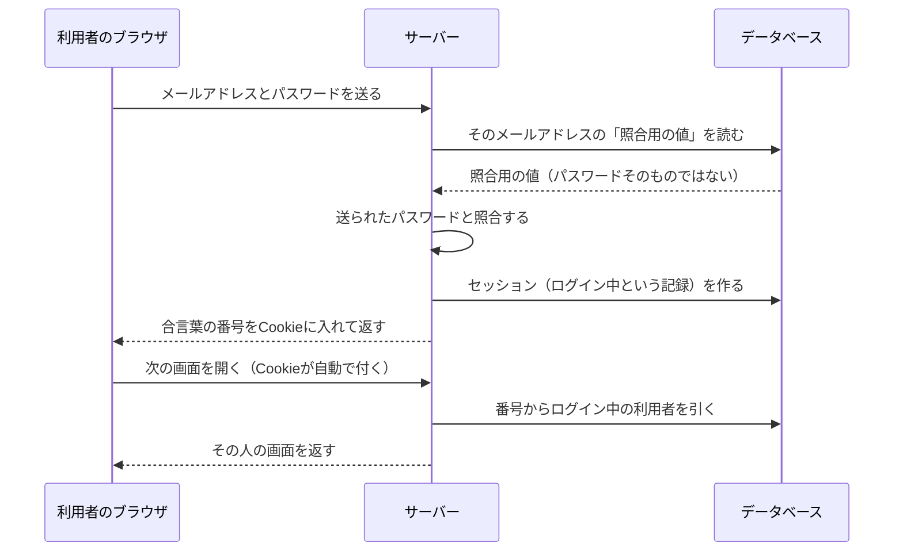
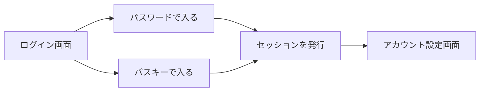

# 01 ログインとは何か

## 機械に「本人かどうか」を判断させる

窓口で人が人を確かめるときは、顔や声、身分証明書など、たくさんの手がかりを同時に使います。
ところがインターネットの向こうにいる相手について、サーバー（利用者の要求を受けて処理するコンピューター）が受け取れるのは、
**送られてきたデータ（文字や数字の並び）だけ**です。

そこでログインでは、「本人しか用意できないはずのデータ」を送ってもらい、それが正しいかを確かめます。
この確かめる手続きを**認証**（にんしょう。相手が名乗ったとおりの本人かを確かめること）と呼びます。

認証の手がかりは、昔から次の 3 種類に分けられています。

| 種類 | 例 | このプロジェクトでの扱い |
|---|---|---|
| 知っているもの | パスワード | 使う（02, 03 章） |
| 持っているもの | スマートフォン、セキュリティキー | パスキーとして使う（05 章） |
| 本人そのもの | 指紋、顔 | パスキーの端末の中で使う。サーバーには送られない（05 章） |

## 「名乗る」と「確かめる」は別のこと

ログイン画面でメールアドレスを入れるのは「私は ○○ です」と**名乗る**ことで、これを**識別**（しきべつ。誰のことかを特定すること）と呼びます。
メールアドレスは他人も知りうる情報なので、名乗るだけでは本人だと言えません。
パスワードやパスキーで**確かめる**のが認証です。

この区別は、後の章で何度も出てきます。たとえば「パスワードを忘れたらメールで再設定」という仕組みは、
メールが届く＝その受信箱を使える人だ、ということしか分かりません。そのため、このプロジェクトでは
メールを**認証**には使わず、**回復**（アカウントを取り戻す手段）にだけ使います（08 章、設計書の S11）。

## サーバーがやっていること

ログイン 1 回の中で、サーバーは大きく 3 つのことをしています。



図の **Cookie**（クッキー）は、サーバーがブラウザに預けておく小さなメモで、同じサイトに次の要求を送るときにブラウザが自動で付けて返します（詳しくは 04 章）。

1. **照合する**: 送られてきたパスワードが正しいかを確かめる。サーバーはパスワードそのものを持っていません。
   持っているのは「照合はできるが、元のパスワードには戻せない値」です（02 章）。
2. **覚える**: 一度確かめたら、画面を移動するたびにパスワードを聞き直さなくて済むように、「この人はログイン済み」と覚えます。
   これが**セッション**（ログインしている間の状態の記録）です（04 章）。
3. **記録する**: ログインに成功した・失敗した、という出来事を**監査ログ**（あとから調べるための出来事の記録）に残します（S12）。

このプロジェクトでは、この流れを次の「ルート」（どの URL に来た要求をどの処理に渡すかの決まり）に分けて書いています。

```ts
// 出典: src/server.ts:85-92
  void app.register(pageRoutes);
  void app.register(signupRoutes);
  void app.register(loginRoutes);
  void app.register(logoutRoutes);
  void app.register(passkeysRoutes);
  void app.register(passkeyLoginRoutes);
  void app.register(accountRoutes);
  void app.register(resetRoutes);
```

`signup`（新規登録）、`login`（パスワードでのログイン）、`logout`（ログアウト）、`passkeys` と `passkeyLogin`（パスキーの登録とログイン）、
`account`（アカウント設定）、`reset`（パスワード忘れ）です。06〜08 章でこれらのファイルを順に読みます。

## 何を守るのか

ログインの仕組みが守りたいものは、つきつめると次の 2 つです。

- **なりすまされないこと**: 他人が本人のふりをしてログインできないこと
- **漏れても使えないこと**: サーバーの中身が盗まれても、そこからログインに使える情報が取り出せないこと

前者だけを考えると「パスワードを照合できればよい」となり、パスワードをそのまま保存してしまいがちです。
しかし保存した中身が盗まれた瞬間に、全員分のパスワードが攻撃者の手に渡ります。
しかも多くの人は同じパスワードを別のサービスでも使っているので、被害はそのサービスの外にも広がります。

後者の「漏れても使えない」を最初から設計に入れておくことが、この見本のいちばんの狙いです（00 章の設計原則）。

## パスワードとパスキー、2 つの入口

このプロジェクトのログインには入口が 2 つあります。



- **パスワード**: 多くの人が慣れている方法です。ただし、偽サイト（本物そっくりに作られた別のサイト）に入力すると盗まれる弱点があります。
- **パスキー**: 端末（スマートフォンやパソコン）の中にある鍵で、本人であることを確かめる方法です。
  偽サイトでは働かない仕組みになっています（05 章）。

どちらで入っても、最後は同じ「セッションの発行」にたどり着きます。
入口ごとに別の仕組みを作ると、片方の対策を直したのにもう片方が古いまま、ということが起きやすいためです。

次の章では、パスワードの入口を支える「正しい持ち方」を見ていきます。
