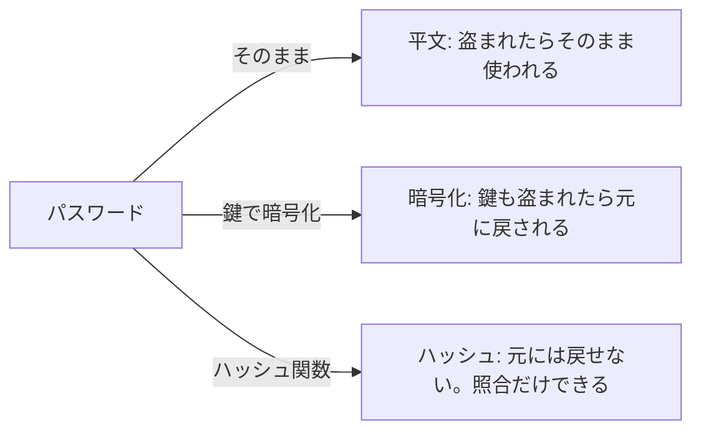
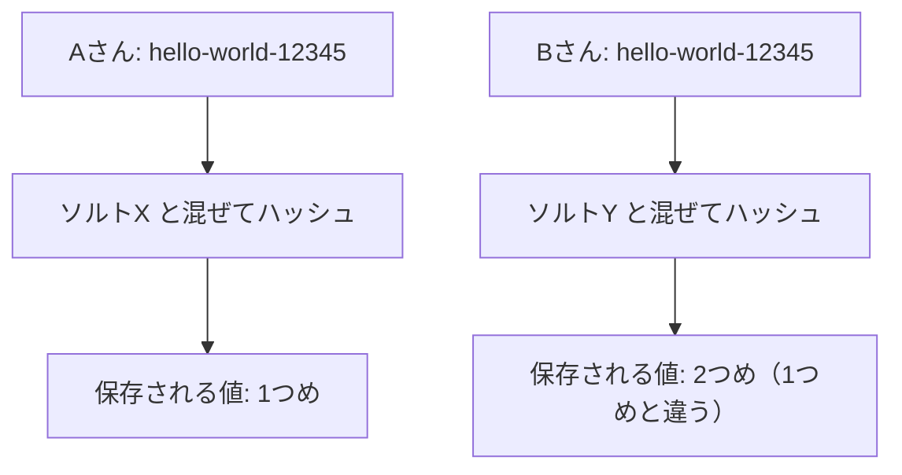

# 02 パスワードの正しい持ち方

## なぜ「持ち方」が問題になるのか

2026 年、KDDI が ISP 事業者向けに提供しているメールシステムへの不正アクセスで、7,616,173 件のパスワードが漏えいしたと公表されました
（KDDI「ISP事業者向けメールシステムへの不正アクセスに関するご報告」2026 年 7 月 6 日、7 月 21 日更新。
https://newsroom.kddi.com/news/assets/2026/kddi_nr_s-73_4619/kddi_nr_s-73_4619_pdf_01.pdf ）。

パスワードを平文（ひらぶん。何も加工していない、そのまま読める形）で保存していると、データベースが盗まれた瞬間に、そこに書かれたパスワードがそのまま攻撃者の手に渡ります。
多くの人は同じパスワードを別のサービスでも使っているので、被害はそのサービスだけでは終わりません。

NIST（米国国立標準技術研究所）のデジタル認証の指針 SP 800-63B-4 は、パスワードを**ソルト付きのハッシュ**で保存することを求めています。
この章では、その言葉の意味を順に説明します。

## 平文・暗号化・ハッシュの違い

パスワードの保存方法は、大きく 3 つに分けられます。



- **平文**: 論外です。DB を見られた時点で終わりです。
- **暗号化**（あんごうか。鍵を使って読めない形にし、同じ鍵で元に戻せる変換）: 一見安全そうですが、
  **元に戻せる**ことが弱点です。サーバーは照合のために鍵を持っているので、サーバーごと盗まれると鍵も一緒に盗まれ、全員分が元に戻されます。
- **ハッシュ**（元に戻せない変換）: 同じ入力からは必ず同じ出力が出るが、出力から入力を計算で求めることはできない、という性質の変換です。
  ログインのときは、入力されたパスワードを同じ方法で変換し、保存してある値と一致するかを比べます。

サーバーはパスワードを「知っている」必要はありません。「照合できる」だけで足ります。
だから、**元に戻せない形で持つ**のが正しい選択です。

## ハッシュだけでは足りない理由: 塩（ソルト）

ハッシュには弱点が 1 つあります。同じパスワードからは同じ値が出るので、
攻撃者は「よく使われるパスワードとそのハッシュの対応表」を前もって作っておけます。盗んだ DB とその表を照らし合わせるだけで、
多くのパスワードが見つかってしまいます。

そこで、利用者ごとに違う**ソルト**（塩。ハッシュの前にパスワードに混ぜる、利用者ごとのランダムな値）を使います。
ソルトが違えば、同じパスワードでも保存される値はまったく別物になり、前もって作った表は役に立ちません。



ソルトは秘密にする必要はなく、ハッシュの値と一緒に保存しておきます（照合のときに同じソルトを使うため）。

## 遅いハッシュを選ぶ理由: Argon2id

もう 1 つの工夫は、**わざと計算に時間とメモリがかかるハッシュ**を使うことです。

ふつうのハッシュ関数（SHA-256 など）は、とても速く計算できるように作られています。
これはファイルの改ざん検知などには便利ですが、パスワードでは攻撃者にとって便利すぎます。
盗んだハッシュに対して、候補のパスワードを 1 秒間に膨大な数だけ試せるからです。

**Argon2id**（アルゴン・ツー・アイ・ディー）は、パスワードの保存のために作られたハッシュの方式で、
1 回の計算に多くのメモリを必要とします（メモリハード）。利用者がログインするときの 1 回分は気にならない程度ですが、
攻撃者が何億回も試そうとすると、メモリが足りずに速度が出ません。

このプロジェクトでは、ハッシュの計算そのものは `argon2` というライブラリ（よく使われる処理をまとめた部品）に任せています。
暗号に関わる処理を自前で書くと、目に見えない誤りが入りやすいからです。

```ts
// 出典: src/auth/password.ts:80-92
/**
 * S1: Argon2id でハッシュ化する。ソルトはライブラリが毎回ランダムに作り、結果の文字列に含める。
 * 利用者ごとにソルトが違うので、同じパスワードでも保存される値は別物になる（事前計算表が効かない）。
 * パラメータはライブラリの既定（メモリ 64MiB・反復 3・並列 4）。OWASP の推奨最低値を上回る。
 */
export async function hashPassword(password: string): Promise<string> {
  return argon2.hash(normalizePassword(password), { type: argon2.argon2id });
}

/** S1: 保存してあるハッシュと照合する。比較はライブラリ内で一定時間で行われる */
export async function verifyPassword(passwordHash: string, password: string): Promise<boolean> {
  return argon2.verify(passwordHash, normalizePassword(password));
}
```

- `hashPassword` は登録やパスワード変更のときに呼ばれ、結果だけが DB に保存されます。
- `verifyPassword` はログインのときに呼ばれ、「一致したか（true / false）」だけを返します。
- `normalizePassword` は、見た目が同じ文字の違い（全角・半角など）をそろえる処理です（03 章）。
- OWASP（オワスプ。Web の安全性について指針を出している国際的な団体）の推奨値を上回る設定を、ライブラリの既定値として使っています。

`argon2.hash` が返す文字列は、`$argon2id$v=19$m=65536,t=3,p=4$（ソルト）$（ハッシュ）` という形をしています。
方式・パラメータ・ソルト・ハッシュが 1 つの文字列にまとまっているので、DB の列は 1 つで足ります。

```sql
-- 出典: src/db/migrations/001_init.sql:9-10
  -- S1: Argon2id のハッシュ（PHC 文字列。ソルトを内包する）。NULL は「パスキーのみ」のユーザー
  password_hash TEXT,
```

列の名前が `password` ではなく `password_hash` なのは、**この列にパスワードそのものを入れてはいけない**ことを名前で示すためです。

## 本当に平文が残っていないかをテストで確かめる

「ハッシュで保存しているはず」と思い込むのは危険です。たとえば、デバッグのために書いたログ出力や、
別の表へのコピーに、うっかりパスワードが残ることがあります。

このプロジェクトでは、登録のあとに**DB の全テーブル・全列**を書き出し、登録に使ったパスワードの文字列がどこにも含まれないことをテストで確かめています
（`test/integration/security.test.ts` の S1、`test/integration/audit.test.ts`）。
テストで使うパスワードも、毎回ランダムに作っています。テストのファイルに具体的なパスワードを書かないためです。

## まとめ

- サーバーはパスワードを「知る」必要はなく、「照合できる」だけでよい
- 暗号化は元に戻せるので不十分。元に戻せないハッシュで持つ
- 利用者ごとのソルトで、事前に作った対応表を無効にする
- Argon2id のような遅い（メモリを食う）ハッシュで、盗まれた後の総当たりを遅くする
- 暗号の処理は自前で書かず、実績のあるライブラリに任せる

次の章では、「どんなパスワードなら受け付けるか」という規則を見ます。
