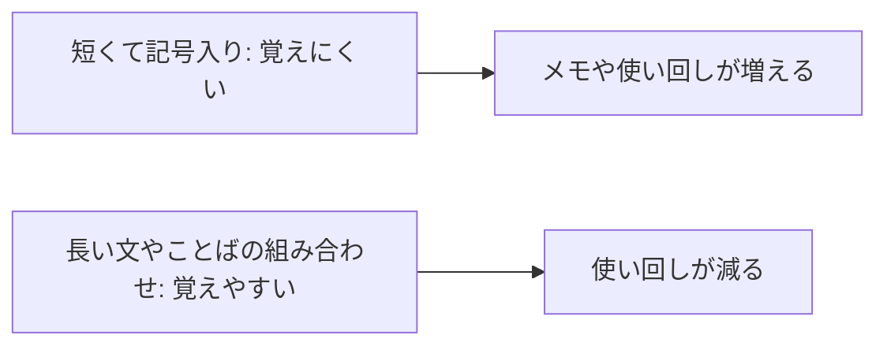

# 03 なぜ15文字で記号は不要なのか

## よくある規則が、かえって弱いパスワードを生む

「8 文字以上で、大文字・小文字・数字・記号をそれぞれ 1 つ以上含めてください」「90 日ごとに変更してください」。
こうした規則を見たことがある人は多いでしょう。

ところが NIST SP 800-63B-4 は、こうした**文字種の強制**（決まった種類の文字を必ず混ぜさせること）と
**定期変更の強制**を、してはいけないこととしています。理由は、人間の行動にあります。

- 文字種を強制すると、多くの人は `Password1!` のように「単語の頭を大文字にして、最後に数字と記号を付ける」形に落ち着きます。
  攻撃者もそれを知っているので、推測しやすくなるだけです。
- 定期変更を強制すると、`Password1!` が `Password2!` になるような小さな変更が増えます。覚えられない規則は、
  メモ書きや使い回しを増やします。

その代わりに NIST が求めるのは、次の 3 つです。

| 規則 | このプロジェクトでの値 | 要件 |
|---|---|---|
| パスワードだけでログインするなら 15 文字以上 | 15 文字以上 | S2 |
| 上限は 64 文字以上にする（長いパスフレーズを拒まない） | 256 文字まで | S2 |
| 漏えいしたことがあるパスワードは拒否する | 同梱の一覧と照合 | S3 |

文字種は問いません。**定期変更も求めません**。変更を求めるのは、漏えいの兆候があるときだけです（S4）。

## なぜ「長さ」なのか

攻撃者がパスワードを推測するとき、試す必要がある組み合わせの数は、**使える文字の種類の数を、文字数の回数だけ掛け合わせた数**になります。
文字の種類を増やすより、文字数を増やすほうが、組み合わせの数はずっと速く増えます。

さらに、長いパスワードは「覚えやすい文」にできます。たとえば、いくつかの単語を並べたパスフレーズ（文やことばの組み合わせで作るパスワード）は、
記号を無理に混ぜた短いパスワードより覚えやすく、推測もされにくくなります。



## コードで見る規則

規則は `src/auth/password.ts` の先頭に定数（後から変わらない値）としてまとめています。

```ts
// 出典: src/auth/password.ts:8-12
// S2: NIST SP 800-63B-4 は「パスワードだけで使うなら 15 文字以上」を求める。
export const MIN_PASSWORD_LENGTH = 15;
// S2: 上限は 64 文字以上にせよ、とされる。長いパスフレーズを拒まない一方で、
// 巨大な入力でハッシュ計算に時間を使わされないよう、十分に大きい上限を置く。
export const MAX_PASSWORD_LENGTH = 256;
```

上限を「無制限」にしないのは、何メガバイトもあるパスワードを送りつけられると、ハッシュの計算（02 章）にサーバーの時間を使わされるからです。
256 文字は、人が実際に使う長さとしては十分すぎる値です。

新しいパスワードを調べる関数は、長さと漏えい一覧**だけ**を見ています。

```ts
// 出典: src/auth/password.ts:54-66
/**
 * 新しく設定するパスワードを検査する。問題がなければ null。
 * S2: 文字種（大文字・数字・記号など）の組み合わせは求めない。NIST は文字種の強制が
 *     「Password1!」のような予測しやすい形を増やすだけだとして禁止している。
 * S4: 定期変更の強制もしない。変更を求めるのは漏えいの兆候があるときだけ（この関数は期限を見ない）。
 */
export function checkNewPassword(password: string): PasswordProblem | null {
  const length = lengthOf(normalizePassword(password));
  if (length < MIN_PASSWORD_LENGTH) return 'too_short';
  if (length > MAX_PASSWORD_LENGTH) return 'too_long';
  if (isBreachedPassword(password)) return 'breached';
  return null;
}
```

この関数は、新規登録・パスワード変更・パスワード再設定の 3 か所すべてで使われます。
規則を 1 か所にまとめておけば、「登録では弾くのに、再設定では通ってしまう」といった食い違いが起きません。

### 文字数の数え方と正規化

`lengthOf` は文字数を「見た目の 1 文字」に近い単位で数えます。絵文字のように、内部では 2 つ分の場所を使う文字を 2 文字と数えないためです。

`normalizePassword` は、Unicode（ユニコード。世界中の文字に番号を振った規格）の正規化（見た目が同じ文字の内部表現をそろえる処理）をしています。
全角の「Ａ」と半角の「A」のように、端末や入力方式によって違う符号で届く文字があり、
そろえないと「正しいパスワードを入れたのに入れない」ことが起きるからです。

## 漏えい一覧との照合

長さが十分でも、過去の漏えい事件で流出したパスワードは、攻撃者の推測リストの先頭に入っています。
そこで、登録や変更のときに**漏えい済みパスワードの一覧**と照合し、含まれていれば拒否します（S3）。

```ts
// 出典: src/auth/password.ts:50-52
export function isBreachedPassword(password: string): boolean {
  return loadBreachedList().has(normalizePassword(password).toLowerCase());
}
```

小文字にそろえて比べるのは、大文字小文字を入れ替えただけの変形がよくある手口だからです。

拒否したときは、**なぜ拒否したかを利用者に伝えます**。理由を言わずに「使えません」とだけ返すと、
利用者は同じパスワードを少し変えて入れ直すだけになりがちです。

```ts
// 出典: src/auth/password.ts:75-76
    case 'breached':
      return 'このパスワードは過去の漏えい事件で流出した一覧に含まれているため使えません。別のパスワードにしてください';
```

同梱の一覧（`src/auth/breached-passwords.txt`）は約 1,000 件の小さなものです。実際のサービスでは、
より大きな一覧や外部の照合サービスを使うことも検討してください（設計書 S3 では任意としています）。

## 貼り付けを妨げない

パスワード管理ツール（長いランダムなパスワードを作って覚えてくれる道具）を使う人にとって、
入力欄への貼り付けを禁止されるのは大きな妨げです。このプロジェクトの登録画面は、貼り付けを禁止せず、文字数の上限（maxlength）も付けていません。

```html
<!-- 出典: src/web/signup.html:24-26 -->
        <!-- S2: 貼り付けを妨げない（パスワード管理ツールで長い値を使えるように）。maxlength も付けない -->
        <input id="password" name="password" type="password" autocomplete="new-password" minlength="15" required
               aria-describedby="password-hint">
```

`autocomplete="new-password"` は、ブラウザやパスワード管理ツールに「ここは新しいパスワードを作る欄だ」と知らせる印です。

## まとめ

- 文字種の強制と定期変更の強制は、かえって推測しやすいパスワードを増やす
- 長さ（15 文字以上）と漏えい一覧の照合で守る。上限は長いパスフレーズを拒まない値にする
- 拒否したときは理由を伝える
- 規則は 1 か所にまとめ、登録・変更・再設定で同じものを使う

ただし、どれほど良いパスワードでも、偽サイトに入力すれば盗まれます。その弱点を補うのが 05 章のパスキーです。
