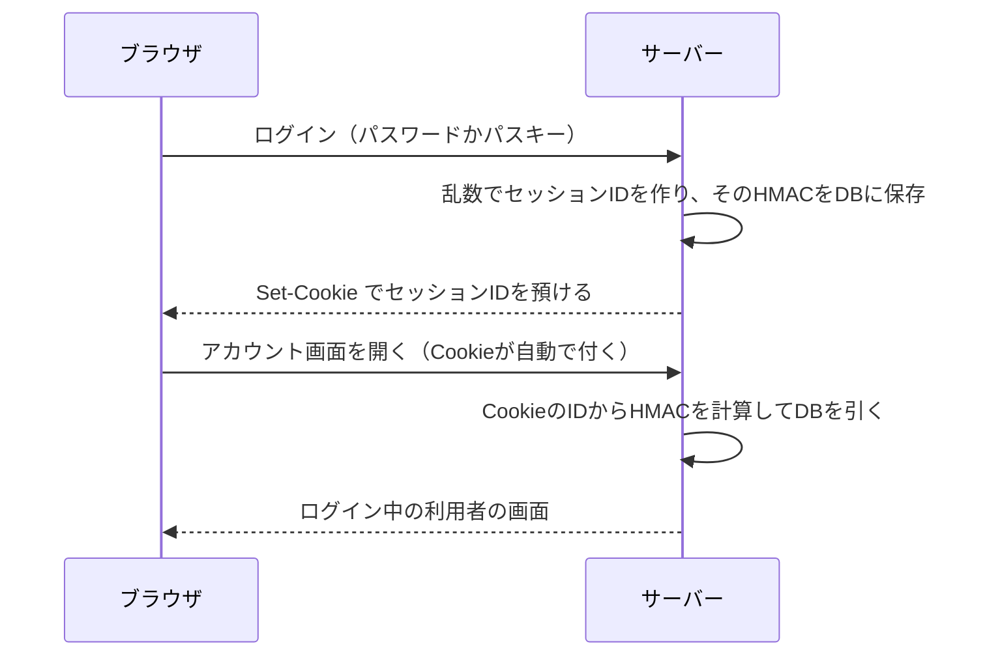

# 04 セッションとCookie

## なぜ「ログイン状態」を覚える仕組みが要るのか

Web の通信に使われる HTTP（ブラウザとサーバーがやりとりするときの決まりごと）は、**1 回ごとに独立**しています。
サーバーは、さっきログインした人と今ページを開いた人が同じかどうかを、そのままでは知りません。

かといって、ページを開くたびにパスワードを送ってもらうのは不便ですし、パスワードが通信に乗る回数も増えます。
そこで、ログインに成功したら**セッション**（ログインしている間の状態の記録）を作り、
その番号（**セッション ID**）をブラウザに預けます。ブラウザは次の要求からその番号を自動で付けて送り、
サーバーは番号を見て「ああ、さっきの人だ」と分かります。

番号を預ける場所が **Cookie**（クッキー。サーバーがブラウザに預け、次の要求から自動で送り返してもらう小さなデータ）です。



セッション ID は、言わば**一時的な合言葉**です。これを盗まれると、パスワードを知らなくても本人になりすませます。
この章では、合言葉を「推測されない」「盗まれにくい」「盗まれても DB からは作れない」ようにする工夫を見ます。

## 推測されない: 256bit の乱数

セッション ID は、`crypto.randomBytes`（Node.js に入っている、予測できない乱数を作る機能）で作った 32 バイト（256bit）の乱数です。
256bit の乱数を当てずっぽうで当てることは、現実的にはできません。
連番や時刻のような「規則のある値」を使うと、他人の番号を推測されてしまいます。

```ts
// 出典: src/auth/session.ts:55-59
export function startSession(request: FastifyRequest, reply: FastifyReply, userId: number): void {
  const db = request.server.db;
  const now = Date.now();
  // S7: 256bit の乱数。推測で他人のセッションに当てることは現実的にできない
  const rawId = randomBytes(32).toString('base64url');
```

## 盗まれにくい: Cookie の属性

Cookie には、**属性**（ブラウザにその Cookie の扱い方を指示する追加の情報）を付けられます。
このプロジェクトでは、セッションの Cookie に次の 3 つを付けています。

```ts
// 出典: src/auth/session.ts:76-85
  void reply.setCookie(sessionCookieName(request), rawId, {
    // S7: HttpOnly。ページの JavaScript から読めないので、XSS があっても Cookie を盗み出せない
    httpOnly: true,
    // S7/S13: SameSite=Lax。他サイトから送られる POST には Cookie が付かない
    sameSite: 'lax',
    // S7: 本番（https）では Secure。平文の通信路に Cookie を流さない
    secure: request.server.config.cookieSecure,
    path: '/',
    maxAge: SESSION_TTL_MS / 1000,
  });
```

| 属性 | 意味 | 防ぐもの |
|---|---|---|
| HttpOnly | ページの JavaScript からは読めない | XSS（クロスサイトスクリプティング。他人がページに悪意のあるスクリプトを紛れ込ませる攻撃）で Cookie を抜き取られること |
| SameSite=Lax | 他のサイトから送られる POST には付けない | CSRF（クロスサイトリクエストフォージェリ。他のサイトから勝手に要求を送らせる攻撃） |
| Secure | https（暗号化された通信）のときだけ送る | 通信の途中で盗み見られること |

Secure は本番だけで付けています。手元で開発するときの `http://localhost` は https ではないので、Secure を付けると Cookie が送られず、ログインできなくなるからです。

本番では、Cookie の名前にも `__Host-` という接頭辞を付けます。ブラウザはこの名前の Cookie を「Secure 付き・Path=/・ドメイン指定なし」のときしか受け取らないので、
同じドメインの別のサブドメイン（`foo.example.com` のような下位の名前）から Cookie を上書きされる攻撃を防げます。

## 盗まれても DB からは作れない: HMAC で保存する

セッション ID も「ログインに使える秘密」なので、パスワードと同じく DB にそのまま保存しません。
保存するのは、`SESSION_SECRET`（設定ファイルに書く、サーバーだけが知る秘密の値）を鍵にした
**HMAC**（エイチマック。秘密の鍵を混ぜて計算するハッシュ）だけです。DB が漏れても、鍵が無ければ有効な Cookie を作れません。

```ts
// 出典: src/auth/session.ts:40-42
function hashSessionId(request: FastifyRequest, rawId: string): Buffer {
  return createHmac('sha256', request.server.config.sessionSecret).update(rawId).digest();
}
```

パスワードには遅いハッシュ（Argon2id）を使いましたが、セッション ID には速い HMAC を使っています。
人が考えたパスワードと違って、256bit の乱数は総当たりで元に戻せないので、わざと遅くする必要がないからです。
ページを開くたびに計算するので、むしろ速いことが大切です。

## ログインのたびに新しい ID にする

ログインの前から持っていた ID を、ログイン後もそのまま使い続けると、
**セッション固定攻撃**（攻撃者が用意した ID を被害者に使わせ、被害者がログインした後にその ID で入る攻撃）が成り立ちます。

そこで、`startSession` はログインのたびに新しい ID を作り、Cookie が指していた古い ID は DB から消します。

パスワードを変更したときも同じ考え方で、ほかの端末のセッションをすべて消し、今の端末にも新しい ID を発行し直します（`src/routes/account.ts`）。

## CSRF をもう一段防ぐ: Origin ヘッダの検証

SameSite=Lax だけでも、他サイトからの POST には Cookie が付きません。
しかし古いブラウザや、同じサイトの別のサブドメインからの攻撃などに備えて、もう一段の確認をしています。
状態を変える要求（POST など）では、ブラウザが自動で付ける **Origin ヘッダ**（要求がどのサイトの画面から送られたかを示す情報）を見て、
自分のサイトからでなければ断ります（S13）。

```ts
// 出典: src/auth/origin.ts:14-19
export async function verifyOrigin(request: FastifyRequest, reply: FastifyReply): Promise<void> {
  if (SAFE_METHODS.has(request.method)) return;
  if (request.headers.origin === request.server.config.origin) return;
  request.log.warn({ origin: request.headers.origin ?? null }, 'Origin が一致しない要求を拒否しました');
  await reply.code(403).send({ message: '不正な送信元からの要求のため、処理しませんでした' });
}
```

この確認は、ルートごとに書くのではなく、`src/server.ts` で**すべての要求に 1 か所で**掛けています。
ルートごとに書くと、新しいルートを足したときに付け忘れるからです。
ログアウトを GET ではなく POST にしているのも同じ理由で、GET で状態を変えると、他サイトの画像タグ 1 つで勝手にログアウトさせられてしまいます。

## セッションの終わらせ方

| 場面 | すること | 場所 |
|---|---|---|
| ログアウト | この端末のセッションを DB から消し、Cookie も消す | `src/routes/logout.ts` |
| すべての端末でログアウト | その利用者の全セッションを消す | `src/routes/logout.ts` |
| パスワード変更 | 全セッションを消し、変更した端末には新しい ID を発行する | `src/routes/account.ts` |
| パスワード再設定 | 全セッションを消す。ログイン状態にはしない（S11） | `src/routes/reset.ts` |
| 24 時間たった | 期限切れとして扱い、次の発行のついでに掃除する | `src/auth/session.ts` |

Cookie を消すだけでは足りません。Cookie の値がどこかに控えられていたら、サーバー側に記録が残っている限り使えてしまうからです。
**サーバー側の記録を消すこと**が、本当の意味でのログアウトです。

## まとめ

- セッション ID はログイン中の合言葉。256bit の乱数で作る
- Cookie には HttpOnly・SameSite=Lax・Secure（本番）を付ける
- DB には ID そのものではなく HMAC だけを持つ
- ログインやパスワード変更のたびに ID を作り直す
- 状態を変える要求は Origin を確かめる。確認は全ルートに 1 か所で掛ける
