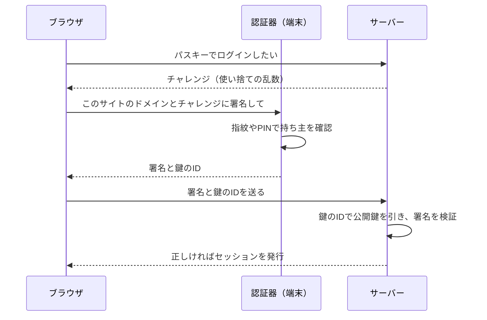
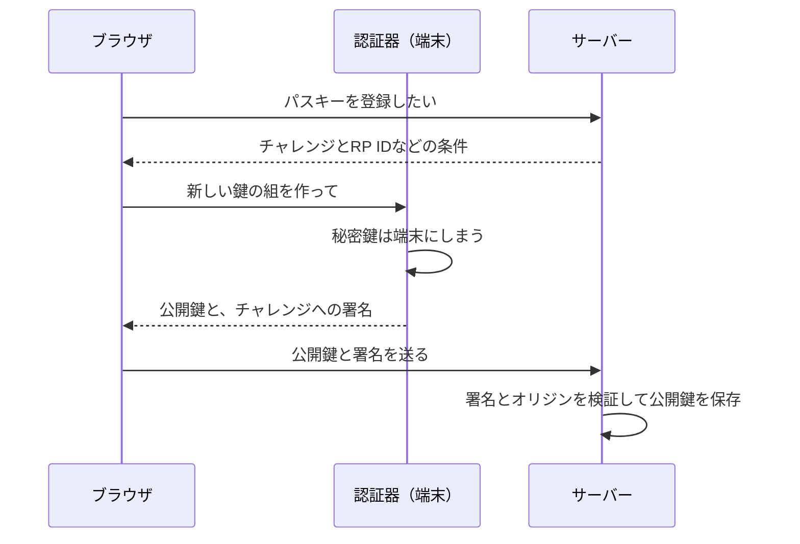

# 05 パスキーの仕組み

## パスワードに残る 2 つの弱点

02〜04 章で、パスワードを正しく保存し、正しく扱う方法を見てきました。それでも、パスワードには仕組みそのものの弱点が 2 つ残ります。

1. **偽サイトに入力すると盗まれる**: パスワードは「同じ文字列を送れば通る」秘密なので、
   本物そっくりの偽サイトで入力させられると、攻撃者はそれを本物のサイトに入れるだけでログインできます。
   これを**フィッシング**（偽サイトや偽メールで秘密を入力させて盗む攻撃）と呼びます。
2. **サーバーと利用者が同じ秘密を共有している**: サーバーはハッシュの形とはいえ、照合のための値を持っています。

NIST SP 800-63B-4 は、パスワードやワンタイムパスワード（1 回だけ使えるコード）を「フィッシング耐性なし」と分類しています。
ワンタイムパスワードも、偽サイトに入力させて、その場で本物のサイトに中継すれば使えてしまうからです。

**パスキー**は、この 2 つの弱点を仕組みで取り除いた認証方法です。WebAuthn（ウェブオースン。ブラウザでパスキーを使うための標準規格）という仕様に沿って動きます。

## 鍵の組: 秘密鍵と公開鍵

パスキーは**公開鍵暗号**（2 つで 1 組の鍵を使う暗号の仕組み）を使います。

- **秘密鍵**: 利用者の端末（スマートフォン、パソコン、セキュリティキー）の中にだけあり、外に出ない。**署名**（その鍵の持ち主にしか作れない、データへの印）を作るのに使う。
- **公開鍵**: サーバーに預ける。署名が対になる秘密鍵で作られたものかを**確かめる**ことはできるが、署名を作ることはできない。

つまり、サーバーが持つのは公開鍵だけです。公開鍵が漏れても、それを使ってログインすることはできません。
00 章の「漏れても使えないものだけを持つ」を、仕組みそのもので満たしているわけです。

```sql
-- 出典: src/db/migrations/001_init.sql:16-22
CREATE TABLE credentials (
  id            INTEGER PRIMARY KEY,
  user_id       INTEGER NOT NULL REFERENCES users(id) ON DELETE CASCADE,
  -- 認証器が発行する ID。ログイン時はこの値でどの公開鍵を使うかを引く
  credential_id BLOB    NOT NULL UNIQUE,
  -- 公開鍵。漏れてもログインには使えない（秘密鍵は利用者の端末にしかない）
  public_key    BLOB    NOT NULL,
```

秘密鍵を持ち、署名を作る装置を**認証器**（にんしょうき。端末に内蔵された仕組みや、USB で差すセキュリティキーなど）と呼びます。
指紋や顔、端末の PIN（暗証番号）は、認証器が「持ち主が今ここにいるか」を確かめるために端末の中で使うもので、サーバーには送られません。

## ログインの流れ: チャレンジに署名する

パスキーでのログインは、サーバーが出す問題（**チャレンジ**。毎回変わる使い捨ての乱数）に、端末が秘密鍵で署名して返すことで行います。



チャレンジが毎回違うので、一度盗み見た署名をもう一度送っても通りません（使い回しを防ぐ）。
このプロジェクトでは、チャレンジを 5 分で無効にし、1 回使ったら消しています（`src/auth/challenges.ts`）。

## 偽サイトで効かない理由: RP ID

いちばん大切なのは、**認証器が、署名を求めてきたサイトのドメインを自分で確かめる**ことです。

パスキーは登録したときに、サイトのドメインと結びつけられます。このドメインを **RP ID**（リライングパーティー ID。パスキーが結びつくサイトの識別子）と呼びます。
偽サイト（たとえば本物と一文字違いのドメイン）が署名を求めても、ブラウザと認証器は「このドメイン用のパスキーは無い」と判断し、署名しません。
利用者が見た目にだまされても、**機械がだまされない**のがパスワードとの決定的な違いです。

さらにサーバー側でも、署名と一緒に送られてくる「どのサイトで署名したか」の情報（オリジン）が自分のものかを確かめます。

```ts
// 出典: src/auth/passkey.ts:35-38
  return generateRegistrationOptions({
    rpName: config.rpName,
    // S5: RP ID は設定から固定。パスキーはこのドメインにしか使えないので、偽サイトでは働かない
    rpID: config.rpId,
```

`config.rpId` は `.env` の `RP_ID` から読みます。本番では自分のサービスのドメインにします（10 章）。

## 登録の流れ

登録も、チャレンジを使った 2 往復で行います。違うのは、端末が**新しい鍵の組を作り、公開鍵をサーバーに渡す**ことです。



登録の条件として、このプロジェクトは次の 2 つを指定しています。

```ts
// 出典: src/auth/passkey.ts:50-55
    authenticatorSelection: {
      // S5: Discoverable Credential（端末側にユーザー情報を持つ鍵）。メールを打たずに選ぶだけでログインできる
      residentKey: 'required',
      // S5: user verification = preferred。指紋や PIN が使える端末では使い、無い鍵でも登録できるようにする
      userVerification: 'preferred',
    },
```

- **Discoverable Credential**（ディスカバラブル・クレデンシャル。どのアカウント用かを端末側が覚えている鍵）にすると、
  ログインのときにメールアドレスを入れなくても、端末が「このサイトのアカウント」を一覧から選ばせてくれます。
- **user verification**（ユーザー検証。指紋や PIN で持ち主本人かを確かめること）は `preferred`（できればする）にしています。
  指紋センサーなどが無いセキュリティキーでも登録できるようにするためです。

## 自動入力から 1 タップで入る: 条件付き UI

ログイン画面のメールアドレス欄には、次のような印を付けています。

```html
<!-- 出典: src/web/login.html:14-15 -->
        <!-- 条件付き UI: autocomplete に webauthn を含めると、この欄の自動入力候補にパスキーが並ぶ（S5） -->
        <input id="email" name="email" type="email" autocomplete="username webauthn" required>
```

`webauthn` を含めると、ブラウザはこの欄の自動入力の候補に、保存されているパスキーを並べます。
これを**条件付き UI**（パスキーがあるときだけ、自動入力の形で控えめに出す画面の作り）と呼びます。
パスキーを持っている人は候補を選ぶだけで入れ、持っていない人はふつうにパスワードを入れられます。

## 鍵の複製を見つける: 署名カウンタ

認証器の多くは、署名するたびに 1 ずつ増える**署名カウンタ**を応答に含めます。
サーバーは前回の値を覚えておき、今回の値が前回以下（巻き戻り）なら、鍵が複製された兆候として拒否します（S6）。
この検査は `@simplewebauthn/server` に任せ、拒否したときは監査ログに `counter_rollback` と残します（`src/auth/passkey.ts`）。

なお、端末をまたいで同期されるパスキーなど、カウンタを常に 0 で返す認証器もあります。その場合は巻き戻りの検査は働きません。

## パスキーを失くしたら

端末を失くすと、その端末の秘密鍵も失われます。このプロジェクトでは、次のように回復します（設計書 §7-5）。

- パスワードも登録していれば、パスワードでログインして、新しい端末でパスキーを登録し直す
- パスワードが無ければ、パスワード再設定のメールでパスワードを設定し、そのあとパスキーを登録し直す（08 章）

複数の端末でパスキーを登録しておくと、1 台を失くしても困りません。アカウント設定画面から何本でも追加できます。

## まとめ

- パスキーは鍵の組を使う。秘密鍵は端末に、公開鍵だけがサーバーに
- チャレンジに署名させるので、盗み見た署名は使い回せない
- RP ID でドメインに結びつくので、偽サイトでは署名しない（フィッシングに強い）
- 暗号の処理は `@simplewebauthn/server` と `@simplewebauthn/browser` に任せる
