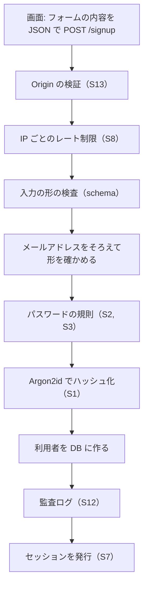

# 06 コードを読む: 登録

この章から、実際のファイルを上から順に読みます。最初は新規登録（`src/routes/signup.ts`）です。
55 行ほどの短いファイルですが、02〜04 章で説明した考え方がほとんど詰まっています。

## 全体の流れ

ブラウザで「登録する」を押してから、アカウント設定画面が開くまでに、要求は次の順で関所を通ります。



B は `src/server.ts` で全ルートに掛けている確認（04 章）、C 以降がこのファイルの中身です。

## 画面側: フォームを JSON で送る

登録画面（`src/web/signup.html`）のフォームは、`src/web/app.js` の `submitJson` で送られます。

```js
// 出典: src/web/app.js:41-58
/**
 * data-json の付いたフォームを JSON で送る（パスワードの登録・ログイン・変更、ログアウト、再設定）。
 * ページを再読み込みしないのは、失敗の理由（たとえば S3 の「漏えい一覧にある」）を、入力を消さずに伝えるため。
 */
async function submitJson(form) {
  const body = Object.fromEntries(new FormData(form));
  try {
    const data = await api('POST', form.getAttribute('action'), body);
    if (data.redirect) {
      location.assign(data.redirect);
      return;
    }
    showMessage(data.message || '完了しました', false, form);
    form.reset();
  } catch (err) {
    showMessage(err.message, true, form);
  }
}
```

JSON（ジェイソン。データを文字で表す書式の 1 つ）で送り、サーバーが返した文言をそのまま画面に出します。
UI フレームワーク（画面を作るための大きな部品集）を使わず素の JavaScript で書いているのは、
「どの要求がいつ飛ぶか」をそのまま読めるようにするためです。

## サーバー側: ルートの宣言

```ts
// 出典: src/routes/signup.ts:9-26
export const signupRoutes: FastifyPluginCallback = (app, _opts, done) => {
  app.post<{ Body: { email: string; password: string } }>(
    '/signup',
    {
      // S8: 登録の連打（アカウントの大量作成や、登録済みメールの探索）を IP ごとに抑える
      config: { rateLimit: app.authRateLimit },
      schema: {
        body: {
          type: 'object',
          required: ['email', 'password'],
          properties: {
            email: { type: 'string', maxLength: 1024 },
            // 長さの規則（S2）はここではなく checkNewPassword で調べ、理由を日本語で返す
            password: { type: 'string', maxLength: 4096 },
          },
        },
      },
    },
```

- `app.post('/signup', ...)` は「`/signup` に来た POST の要求をこの処理に渡す」という宣言です。Fastify（ファスティファイ。このプロジェクトで使っている Web サーバーの部品）の書き方です。
- `config: { rateLimit: ... }` は**レート制限**（同じ相手からの要求を、一定時間に一定回数までに絞る仕組み）です。既定では 15 分あたり 30 回です（`src/server.ts`）。
- `schema` は**入力の形の検査**です。メールとパスワードが文字列で届いているか、異常に長くないかを、処理の前に確かめます。
  形がおかしい要求は、ここで 400（入力が正しくない、という意味の応答番号）として断られます。

`password` の `maxLength: 4096` は、03 章の上限（256 文字）とは別のものです。
これは「明らかにおかしい巨大な入力」を早めに断るための値で、利用者向けの規則（15〜256 文字）は次の `checkNewPassword` が理由付きで返します。

## サーバー側: 本体

```ts
// 出典: src/routes/signup.ts:27-52
    async (request, reply) => {
      const email = normalizeEmail(request.body.email);
      if (!isPlausibleEmail(email)) {
        return reply.code(400).send({ message: 'メールアドレスの形が正しくありません' });
      }
      // S2 / S3: 長さと漏えい一覧だけを調べる。文字種は問わない
      const problem = checkNewPassword(request.body.password);
      if (problem) {
        return reply.code(400).send({ message: passwordProblemMessage(problem), reason: problem });
      }

      // S1: 保存するのはハッシュだけ。生のパスワードはこの関数を出たら残らない
      const passwordHash = await hashPassword(request.body.password);
      const userId = createUser(app.db, { email, passwordHash, now: Date.now() });
      if (userId === null) {
        // 登録済みであることは、この画面では伝えざるを得ない（伝えないと本人が先へ進めない）。
        // 列挙の速度はレート制限（S8）で抑える。確認メールを挟む方式にするかは未決（threat-model.md §10）。
        return reply.code(409).send({
          message:
            'このメールアドレスでは登録できません。登録済みの場合はログインするか、パスワードの再設定をお試しください',
        });
      }
      audit(request, 'signup', userId, { method: 'password' });
      startSession(request, reply, userId);
      return reply.code(201).send({ redirect: '/account' });
    },
```

上から順に読んでいきます。

1. **メールアドレスをそろえる**（`normalizeEmail`）: 前後の空白を除き、小文字にします。
   `User@Example.com` と `user@example.com` が別のアカウントになると、本人が入れなくなったり、同じ人のアカウントが二重にできたりするからです。
2. **形を確かめる**（`isPlausibleEmail`）: `@` の前後に文字があるか程度の、ゆるい確認です。
   本当に届くアドレスかどうかは、メールを送ってみないと分かりません。
3. **パスワードの規則**（`checkNewPassword`）: 03 章の関数です。問題があれば、理由を日本語で返します。
4. **ハッシュ化**（`hashPassword`）: 02 章の関数です。この行より後では、生のパスワードは使いません。
5. **利用者を作る**（`createUser`）: DB に 1 行を足します。
6. **監査ログ**（`audit`）: 「誰が・いつ・どこから登録したか」を残します。パスワードは書きません。
7. **セッションを発行**（`startSession`）: 04 章の関数です。登録したらそのままログイン状態になります。

### 「すでに登録されています」をどう伝えるか

5 の `createUser` は、同じメールアドレスがすでにあると `null` を返します。
このときは 409（すでにあるものと衝突した、という意味の応答番号）を返します。

本当は、「このメールアドレスは登録済みです」と分かる応答は、**列挙**（応答の違いから、あるメールアドレスが登録済みかを探られること）の手がかりになります。
ログインやパスワード忘れの画面では、登録の有無で応答を変えないようにしています（07, 08 章）。
しかし新規登録の画面では、伝えないと本人が先に進めません。そこで、このプロジェクトではレート制限で探る速度を抑えるにとどめ、
確認メールを挟む登録方式にするかどうかは、判断待ちとして残しています（`docs/threat-model.md` §6, §10）。

### 「探してから入れる」をしない理由

`createUser` の中は、「同じメールがあるか探す → 無ければ入れる」ではなく、「とりあえず入れて、重複で失敗したら null を返す」という作りになっています。

```ts
// 出典: src/db/repo/users.ts:18-31
export function createUser(
  db: Db,
  user: { email: string; passwordHash: string | null; now: number },
): number | null {
  try {
    const result = db
      .prepare('INSERT INTO users (email, password_hash, created_at) VALUES (?, ?, ?)')
      .run(user.email, user.passwordHash, user.now);
    return Number(result.lastInsertRowid);
  } catch (err) {
    if (isUniqueViolation(err)) return null;
    throw err;
  }
}
```

「探す」と「入れる」の間に、同じメールでの別の登録が割り込むと、両方が「無かった」と判断して二重に登録されてしまうからです。
DB の UNIQUE 制約（その列に同じ値を 2 つ入れさせない決まり）に判定を任せれば、割り込みが起きても片方だけが成功します。

SQL（エスキューエル。DB に指示を出すための言語）の `?` は、値を後から差し込む場所です。
文字列をつなげて SQL を組み立てると、入力に紛れ込ませた SQL の断片が実行される **SQL インジェクション**が起きうるので、値は必ずこの形で渡します。

## パスキーでの登録

パスキーでの登録（`src/routes/passkeys.ts`）は 05 章の 2 往復になりますが、最後に DB へ保存するところの考え方は同じです。

```ts
// 出典: src/routes/passkeys.ts:107-116
      // ユーザー作成と鍵の保存を 1 トランザクションにする。片方だけ成功した「鍵の無いユーザー」を残さないため
      const saved = db.transaction(() => {
        let userId = pending.userId ?? null;
        if (userId == null) {
          // パスワードを持たない「パスキーのみ」のユーザーとして作る（§5）。開始から完了までの間に同じメールで
          // 登録された場合は、UNIQUE 制約で null が返る
          if (!pending.email) return undefined;
          userId = createUser(db, { email: pending.email, passwordHash: null, now });
          if (userId === null) return undefined;
        }
```

**トランザクション**（いくつかの DB の操作を「全部成功」か「全部なかったこと」のどちらかにまとめる仕組み）を使い、
利用者の作成と公開鍵の保存を 1 つにまとめています。途中で失敗したとき、「パスワードも鍵も無い、誰もログインできない利用者」が残らないようにするためです。

`passwordHash: null` が、05 章で触れた「パスキーのみ」の利用者です。この利用者も、あとからパスワード再設定のメールでパスワードを足せます。

## まとめ

- 要求は「Origin → レート制限 → 形の検査 → 規則 → ハッシュ化 → 保存 → 記録 → セッション」の順に関所を通る
- 生のパスワードはハッシュ化した後は使わない
- 「探してから入れる」ではなく UNIQUE 制約に判定を任せる
- 関連する複数の書き込みはトランザクションにまとめる
