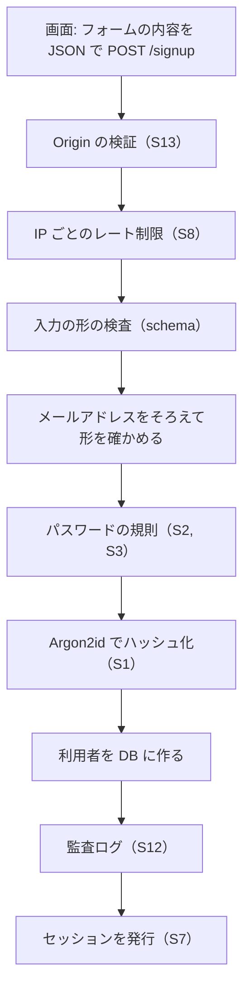

# 06 コードを読む: 登録

この章から実際のファイルを読みます。最初は新規登録（`src/routes/signup.ts`）です。02〜04 章の考え方がほとんど詰まっています。

## 全体の流れ

「登録する」を押してから、要求は次の順で関所を通ります。



画面（`src/web/signup.html`）のフォームは、`src/web/app.js` の `submitJson` が JSON（ジェイソン。データを文字で表す書式の 1 つ）で送り、
サーバーが返した文言をそのまま画面に出します。B は `src/server.ts` で全ルートに掛けている確認（04 章）、C 以降がこのファイルの中身です。

## ルートの宣言

```ts
// 出典: src/routes/signup.ts:10-14
  app.post<{ Body: { email: string; password: string } }>(
    '/signup',
    {
      // S8: 登録の連打（アカウントの大量作成や、登録済みメールの探索）を IP ごとに抑える
      config: { rateLimit: app.authRateLimit },
```

- `app.post('/signup', ...)` は「`/signup` に来た POST の要求をこの処理に渡す」という宣言です。Fastify（ファスティファイ。このプロジェクトで使っている Web サーバーの部品）の書き方です。
- `rateLimit` は**レート制限**（同じ相手からの要求を、一定時間に一定回数までに絞る仕組み）です。相手は **IP アドレス**（要求の送り元を表す番号）で見分け、既定では 15 分あたり 30 回です。
- この後に続く `schema` は**入力の形の検査**です。文字列で届いているか、異常に長くないかを処理の前に確かめ、おかしければ 400（入力が正しくない、という意味の応答番号）で断ります。

## 本体

```ts
// 出典: src/routes/signup.ts:27-53
    async (request, reply) => {
      const email = normalizeEmail(request.body.email);
      if (!isPlausibleEmail(email)) {
        return reply.code(400).send({ message: 'メールアドレスの形が正しくありません' });
      }
      // S2 / S3: 長さと漏えい一覧だけを調べる。文字種は問わない
      const problem = checkNewPassword(request.body.password);
      if (problem) {
        return reply.code(400).send({ message: passwordProblemMessage(problem), reason: problem });
      }

      // S1: 保存するのはハッシュだけ。生のパスワードはこの関数を出たら残らない
      const passwordHash = await hashPassword(request.body.password);
      const userId = createUser(app.db, { email, passwordHash, now: Date.now() });
      if (userId === null) {
        // 登録済みであることは、この画面では伝えざるを得ない（伝えないと本人が先へ進めない）。
        // 列挙の速度は IP ごとのレート制限（S8）で抑える。確認メールを挟む方式は v1.0 の範囲外とし、
        // 受け入れたリスクとしている（人間の判断 1、threat-model.md §6）。
        return reply.code(409).send({
          message:
            'このメールアドレスでは登録できません。登録済みの場合はログインするか、パスワードの再設定をお試しください',
        });
      }
      audit(request, 'signup', userId, { method: 'password' });
      startSession(request, reply, userId);
      return reply.code(201).send({ redirect: '/account' });
    },
```

1. **メールアドレスをそろえる**（`normalizeEmail`）: 前後の空白を除き、小文字にします。大文字小文字で別のアカウントができないようにするためです。
2. **形を確かめる**（`isPlausibleEmail`）: `@` の前後に文字があるか程度の、ゆるい確認です。
3. **パスワードの規則**（`checkNewPassword`）: 03 章の関数です。問題があれば理由を日本語で返します。
4. **ハッシュ化**（`hashPassword`）: 02 章の関数です。この行より後では、生のパスワードは使いません。
5. **利用者を作り、監査ログを残し、セッションを発行する**: ログにパスワードは書きません。登録したらそのままログイン状態になります（04 章）。

### 「登録済み」を伝える 409 は、受け入れたリスク

`createUser` は、同じメールアドレスがすでにあると `null` を返し、このときは 409（すでにあるものと衝突した、という意味の応答番号）を返します。
この応答は**列挙**（応答の違いから、あるメールアドレスが登録済みかを探られること）の手がかりになります。
**なぜ受け入れたか**: 完全に防ぐには、登録の有無にかかわらず「メールを送りました」と返し、続きをメールのリンクで行う登録方式が要ります。
作りも手順も重くなるので v1.0 の範囲外とし、IP ごとのレート制限で速度を抑えるにとどめました。登録済みと伝えれば、本人をログインや再設定へ案内できる利点もあります。

**自分のサービスで変えるなら**: 会員であること自体を知られたくないサービスでは、この 409 の分岐と、パスキーの登録の同じ分岐（`src/routes/passkeys.ts`）を、
確認メールを挟む方式に作り替えてください。レート制限は多数の IP を使えばまたげます（`docs/threat-model.md` §6）。

### 「探してから入れる」をしない

`createUser` は「同じメールがあるか探す → 無ければ入れる」ではなく、「入れてみて、重複で失敗したら null を返す」作りです。

```ts
// 出典: src/db/repo/users.ts:22-30
  try {
    const result = db
      .prepare('INSERT INTO users (email, password_hash, created_at) VALUES (?, ?, ?)')
      .run(user.email, user.passwordHash, user.now);
    return Number(result.lastInsertRowid);
  } catch (err) {
    if (isUniqueViolation(err)) return null;
    throw err;
  }
```

「探す」と「入れる」の間に同じメールの登録が割り込むと、両方が「無かった」と判断して二重に登録されるからです。
DB の UNIQUE 制約（その列に同じ値を 2 つ入れさせない決まり）に任せれば、片方だけが成功します。
SQL（エスキューエル。DB に指示を出すための言語）の `?` は、値を後から差し込む場所です。
文字列をつなげて SQL を組み立てると、入力に紛れ込ませた SQL の断片が実行される **SQL インジェクション**が起きうるので、値はこの形で渡します。

## パスキーでの登録と、パスキーの追加

パスキーでの新規登録（`src/routes/passkeys.ts`）は 05 章の 2 往復になります。最後に、利用者の作成と公開鍵の保存を
**トランザクション**（いくつかの DB の操作を「全部成功」か「全部なかったこと」のどちらかにまとめる仕組み）にまとめ、
「鍵の無い利用者」が残らないようにしています。

ログイン中の利用者が**パスキーを追加する**ときは、Cookie があるだけでは受け付けません。

```ts
// 出典: src/routes/passkeys.ts:58-63
        // 人間の判断 2: 既存アカウントへの追加には、直近 5 分以内の本人確認（ログイン・再認証）を求める。
        // Cookie を盗んだだけの攻撃者に自分の認証器を登録させないため（threat-model.md §4, routes/reauth.ts）
        if (!isRecentlyReauthenticated(user)) {
          audit(req, 'passkey.register.failure', user.id, { reason: 'reauth_required' });
          return reply.code(403).send(REAUTH_REQUIRED);
        }
```

盗んだ Cookie で攻撃者が自分の認証器を足すと、パスワードを変えられても入り直せてしまうからです（09 章）。そこで 403（許可しない、という意味の応答番号）を返し、直近 5 分以内に**再認証**（ログイン中にあらためて本人であることを確かめること）を済ませたセッションでだけ追加を認めます。
再認証の手段は、パスワード（`POST /account/reauth`）か登録済みのパスキー（`src/routes/reauth.ts`）で、メールは使いません（08 章）。
ログインや登録の直後も本人確認として数えるので、5 分以内ならそのまま追加できます。完了の時点でも同じ確認をもう一度行います。

## まとめ

- 要求は「Origin → レート制限 → 形の検査 → 規則 → ハッシュ化 → 保存 → 記録 → セッション」の順に関所を通る
- 生のパスワードはハッシュ化した後は使わない。重複の判定は UNIQUE 制約に任せる
- 登録での 409 は受け入れたリスク。防ぐなら確認メールを挟む方式に変える
- パスキーの追加には、直近 5 分以内の本人確認を求める
