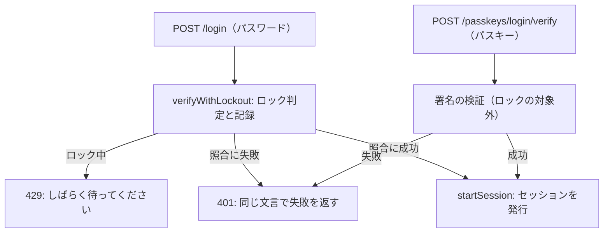

# 07 コードを読む: ログイン

ログインには、パスワード（`src/routes/login.ts`）とパスキー（`src/routes/passkey-login.ts`）の 2 つの経路があります。
入口は違っても、成功したら同じ `startSession` でセッションを発行します。違うのは**連続失敗のロック**の扱いです。

下の図の 401 と 429 は、06 章の 400・409 と同じ種類の応答番号です。
401 は「認証に失敗した」、429 は「要求が多すぎるので、しばらく待ってほしい」という意味です。



## パスワードの経路

```ts
// 出典: src/routes/login.ts:40-61
      const result = await verifyWithLockout(
        app.db,
        { email, userId: user?.id ?? null, ip: request.ip, now },
        () =>
          user?.password_hash
            ? verifyPassword(user.password_hash, request.body.password)
            : verifyAgainstDummy(request.body.password),
      );
      if (result.status === 'locked') {
        audit(request, 'login.locked', user?.id ?? null);
        return reply.code(429).send({ message: LOCKED_MESSAGE });
      }
      const { ok, lockedNow } = result;

      if (!user || !ok) {
        // 監査ログには理由を分けて残す（運用者が攻撃の種類を見分けるため）。利用者への応答は分けない
        audit(request, 'login.failure', user?.id ?? null, {
          reason: user ? 'wrong_password' : 'unknown_email',
        });
        if (lockedNow) audit(request, 'account.locked', user?.id ?? null);
        return reply.code(401).send({ message: BAD_CREDENTIALS_MESSAGE });
      }
```

### 「存在しないメール」と「パスワード違い」を区別しない

失敗の文言（`BAD_CREDENTIALS_MESSAGE`）は「メールアドレスまたはパスワードが違います」の 1 つだけです。
「このメールアドレスは登録されていません」と返すと、攻撃者はメールアドレスの一覧を流し込むだけで、誰が使っているかを調べられます（列挙）。
一方、監査ログには `unknown_email` と `wrong_password` を分けて残します。**利用者（＝攻撃者かもしれない相手）には分けず、運用者には分けて見せる**のがポイントです。

### 時間でも区別させない: ダミーのハッシュ

文言をそろえても、**応答までの時間**が違えば区別できてしまいます。登録済みのメールでだけ Argon2id の照合（時間がかかる）をすると、その差で分かるのです。
そこで、未登録のメールやパスキーのみの利用者では、ダミーのハッシュと照合して同じだけ時間をかけます。

```ts
// 出典: src/auth/password.ts:106-110
export async function verifyAgainstDummy(password: string): Promise<false> {
  dummyHash ??= hashPassword(randomBytes(32).toString('base64url'));
  await argon2.verify(await dummyHash, normalizePassword(password));
  return false;
}
```

成功したら、保存してあるハッシュが今の設定より弱ければ作り直し（`needsRehash`。生のパスワードが手に入るのはこの瞬間だけ）、セッションを発行します。

## 連続失敗のロック: verifyWithLockout

**総当たり**（パスワードを次々に試す攻撃）を止めるため、同じメールアドレスで 5 回続けて失敗すると 15 分間ログインを止めます（S9、`src/auth/lockout.ts`）。
ロック中は、正しいパスワードが来ても照合しません。

ここには落とし穴があります。「ロック中か調べる → 照合する（時間がかかる）→ 記録する」の順に書くと、
照合を待つ間に、同時に送られた大量の要求が「ロック中ではない」と判定を通り抜けてしまうのです。
そこで、判定と「失敗として記録する」を先に 1 つのトランザクションで済ませ（予約）、照合に成功したら記録を成功に書き換えます。

```ts
// 出典: src/auth/lockout.ts:86-91
function reserveAttempt(db: Db, t: AttemptTarget): number | null {
  return db.transaction(() => {
    if (lockedUntil(db, t.email, t.now) !== null) return null;
    return insertLoginAttempt(db, { ...t, succeeded: false, at: t.now });
  })();
}
```

`verifyWithLockout` は照合のしかたを関数で受け取るので、パスワードを照合する経路（ログイン、パスワード変更、パスキー追加の前の再認証）はすべて同じ回数で数えます。
盗んだセッションから再認証の画面でパスワードを試し続けられないようにするためです。
ロックは**未登録のメールアドレスにも同じ規則で掛かります**。登録済みだけがロックされると、「ロックされた＝登録済み」と分かるからです。

## パスキーの経路

開始のときに作ったチャレンジを、Cookie（引換券）で見分けて取り出し、同時に消します（使い切り）。
次に、応答に含まれる鍵の ID で公開鍵を引きます。パスキーでは、メールアドレスの代わりに**鍵が利用者を決めます**。

```ts
// 出典: src/routes/passkey-login.ts:72-81
      // S9: アカウント単位のロックは確かめず、失敗も数えない（冒頭のコメント）。
      // 失敗は監査ログには残すので、同じ鍵を名乗る失敗が続けば運用者は気づける
      const result = await verifyAuthentication(config, req.body.response, pending.challenge, stored);
      if (!result.ok) {
        audit(req, 'passkey.login.failure', owner.id, {
          credential: stored.id,
          kind: failureKind(result.reason),
        });
        return reply.code(401).send(LOGIN_FAILED);
      }
```

署名・チャレンジ・オリジン・署名カウンタを、その鍵の持ち主の公開鍵で確かめます（05 章）。失敗の文言は、どの段階でも同じ `LOGIN_FAILED` です。

### パスキーはロックの対象外

ロックは「推測で当てる」攻撃の速度を落とす仕組みです。パスキーの署名は利用者の端末にある秘密鍵が無ければ作れず、何回試しても当たる見込みは増えません。
ロックを掛けても守りは強くならず、残る効果は、メールアドレスを知る第三者が失敗を送り続けて本人を**締め出す**妨害だけです。
そこで、パスキーの失敗は数えず、パスワードの失敗でロック中のアカウントにもパスキーでは入れるようにしました（ロックされた本人の逃げ道にもなります）。
要求の洪水は、IP ごとのレート制限（1 分あたり 30 回、S8）で抑えます。
自分のサービスでパスキーにもロックを掛けたい場合は、この呼び出しを `verifyWithLockout` で包めば、パスワードと合わせて数えられます。

## まとめ

- 失敗の文言も、所要時間も、登録の有無で変えない（列挙防止）。理由の内訳は監査ログにだけ残す
- 連続失敗のロックは、判定と記録を先に済ませてから照合する（同時の要求で上限をすり抜けさせない）
- パスワードを照合する経路はすべて同じ回数で数える。パスキーはロックの対象外で、IP ごとの制限だけを掛ける
