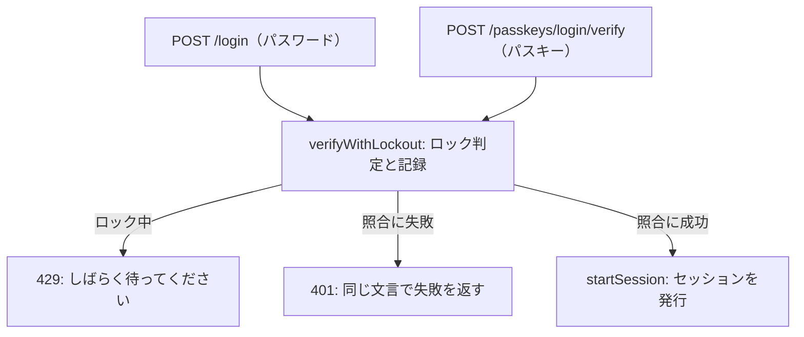

# 07 コードを読む: ログイン

ログインには、パスワード（`src/routes/login.ts`）とパスキー（`src/routes/passkey-login.ts`）の 2 つの経路があります。
2 つの経路は入口こそ違いますが、**連続失敗の数え方**と**セッションの発行**は同じ関数を使っています。

下の図の 401 と 429 は、06 章の 400・409 と同じ種類の応答番号です。
401 は「認証に失敗した」、429 は「要求が多すぎるので、しばらく待ってほしい」という意味です。



## パスワードの経路

```ts
// 出典: src/routes/login.ts:30-61
    async (request, reply) => {
      const now = Date.now();
      const email = normalizeEmail(request.body.email);
      const user = findUserByEmail(app.db, email);

      // S9: ロック中は、正しいパスワードでも照合しない。
      // ロックはメールアドレス単位で、未登録のメールにも同じ規則が働く（ロックの有無から登録を推測させない）
      // 未登録・パスキーのみのユーザーでも、本物と同じだけ時間をかけてから失敗にする（列挙防止）
      // パスキーのみのユーザー（password_hash が NULL）にも同じ失敗を返す。「パスキーでログインしてください」と
      // 返し分けると、そのメールが登録済みだと分かってしまうため。案内はログイン画面に常に出しておく
      const result = await verifyWithLockout(
        app.db,
        { email, userId: user?.id ?? null, ip: request.ip, now },
        () =>
          user?.password_hash
            ? verifyPassword(user.password_hash, request.body.password)
            : verifyAgainstDummy(request.body.password),
      );
      if (result.status === 'locked') {
        audit(request, 'login.locked', user?.id ?? null);
        return reply.code(429).send({ message: LOCKED_MESSAGE });
      }
      const { ok, lockedNow } = result;

      if (!user || !ok) {
        // 監査ログには理由を分けて残す（運用者が攻撃の種類を見分けるため）。利用者への応答は分けない
        audit(request, 'login.failure', user?.id ?? null, {
          reason: user ? 'wrong_password' : 'unknown_email',
        });
        if (lockedNow) audit(request, 'account.locked', user?.id ?? null);
        return reply.code(401).send({ message: BAD_CREDENTIALS_MESSAGE });
      }
```

### 「存在しないメール」と「パスワード違い」を区別しない

失敗したときの文言は、どちらの場合も同じです。

```ts
// 出典: src/routes/login.ts:9-10
// 列挙防止: 「存在しないメール」と「パスワード違い」で同じ文言・同じ状態コードを返す
const BAD_CREDENTIALS_MESSAGE = 'メールアドレスまたはパスワードが違います';
```

「このメールアドレスは登録されていません」と返すと、攻撃者はメールアドレスの一覧を流し込むだけで、
誰がこのサービスを使っているかを調べられます（列挙）。調べた結果は、狙いを絞った攻撃に使われます。

一方、監査ログには `unknown_email` と `wrong_password` を分けて残しています。
**利用者（＝攻撃者かもしれない相手）には分けず、運用者には分けて見せる**のがポイントです。

### 時間でも区別させない: ダミーのハッシュ

文言をそろえても、**応答までの時間**が違えば区別できてしまいます。
登録済みのメールでは Argon2id の照合（時間がかかる）をするのに、未登録のメールでは照合せずにすぐ返すと、その差で分かってしまうのです。

そこで、未登録のメールやパスキーのみの利用者では、ダミーのハッシュと照合して、同じだけ時間をかけてから失敗にしています。

```ts
// 出典: src/auth/password.ts:101-110
/**
 * 存在しないメールでのログインでも、本物と同じだけハッシュ計算をする。
 * これを省くと応答が速く返り、所要時間の差から「そのメールは未登録」と分かってしまう（列挙防止）。
 * ダミーの元になる値は起動ごとの乱数で、どこにも保存しない。
 */
export async function verifyAgainstDummy(password: string): Promise<false> {
  dummyHash ??= hashPassword(randomBytes(32).toString('base64url'));
  await argon2.verify(await dummyHash, normalizePassword(password));
  return false;
}
```

### 成功したとき

```ts
// 出典: src/routes/login.ts:63-69
      // ハッシュのパラメータを強くしたあとは、正しいパスワードが手元にあるこの瞬間に作り直す
      if (user.password_hash && needsRehash(user.password_hash)) {
        updatePasswordHash(app.db, user.id, await hashPassword(request.body.password));
      }
      audit(request, 'login.success', user.id, { method: 'password' });
      startSession(request, reply, user.id);
      return reply.send({ redirect: '/account' });
```

`needsRehash` は、保存してあるハッシュが今の設定より弱いパラメータで作られていないかを調べます。
将来 Argon2id の設定を強くしたとき、生のパスワードが手に入るのはログインの瞬間だけなので、ここで作り直します。

## 連続失敗のロック: verifyWithLockout

**総当たり**（パスワードを次々に試す攻撃）を止めるため、同じメールアドレスで 5 回続けて失敗すると、15 分間ログインを止めます（S9）。
ロック中は、正しいパスワードが来ても照合しません。

```ts
// 出典: src/auth/lockout.ts:10-13
/** S9: この回数だけ続けて失敗したらロックする */
export const LOCKOUT_THRESHOLD = 5;
/** S9: ロックしている時間。利用者が待てる長さで、総当たりの速度は 1 時間に 20 回程度まで落ちる */
export const LOCKOUT_MS = 15 * 60 * 1000;
```

ロックの判定には、気づきにくい落とし穴があります。「ロック中か調べる → 照合する（時間がかかる）→ 結果を記録する」の順に書くと、
照合を待っている間に、同じメールあての要求が大量に「ロック中ではない」と判定を通り抜けてしまうのです。
同時にまとめて送るだけで、5 回の上限を超えて試せてしまいます。

そこで、判定と「失敗として記録する」を先に 1 つのトランザクションで済ませ（予約）、照合に成功したら記録を成功に書き換えます。

```ts
// 出典: src/auth/lockout.ts:74-91
export async function verifyWithLockout(
  db: Db,
  target: AttemptTarget,
  verify: () => Promise<boolean>,
): Promise<GuardedResult> {
  const attemptId = reserveAttempt(db, target);
  if (attemptId === null) return { status: 'locked' };
  const ok = await verify();
  return ok ? markSucceeded(db, target, attemptId) : settleFailure(db, target, attemptId);
}

/** ロック中なら null。そうでなければ「失敗」として 1 行を記録し、その id を返す */
function reserveAttempt(db: Db, t: AttemptTarget): number | null {
  return db.transaction(() => {
    if (lockedUntil(db, t.email, t.now) !== null) return null;
    return insertLoginAttempt(db, { ...t, succeeded: false, at: t.now });
  })();
}
```

`verify` に「照合のしかた」を関数として渡しているので、パスワードでもパスキーでも同じ数え方を使えます。
経路ごとに別々に数えると、片方がロックされている間にもう片方で試し続けられてしまうからです。

ロックはメールアドレス単位で、**未登録のメールアドレスにも同じ規則で掛かります**。
登録済みのメールだけロックされると、「ロックされた＝登録済み」と分かってしまうからです（列挙防止）。

## パスキーの経路

```ts
// 出典: src/routes/passkey-login.ts:60-73
    async (req, reply) => {
      const pending = challenges.take(readCeremonyTicket(req), 'login');
      clearCeremonyCookie(req, reply);
      if (!pending) return reply.code(400).send({ message: '時間が経ちすぎました。もう一度お試しください。' });

      // 応答の credential ID で公開鍵を引く。どのユーザーかは鍵が決める（Discoverable Credential, S5）。
      // 他人の credential ID を名乗っても、その人の公開鍵で署名を検証するので通らない
      const credentialId = credentialIdFromResponse(req.body.response.id);
      const stored = credentialId && findCredentialByCredentialId(db, credentialId);
      const owner = stored ? findUserById(db, stored.userId) : undefined;
      if (!stored || !owner) {
        audit(req, 'passkey.login.failure', null, { kind: 'unknown_credential' });
        return reply.code(401).send(LOGIN_FAILED);
      }
```

1. **チャレンジを取り出す**（`challenges.take`）: 開始のときに作ったチャレンジを取り出し、同時に消します（使い切り）。
   どのチャレンジかは、開始のときに渡した Cookie（引換券）で見分けます。開始したのと同じブラウザでしか完了できないようにするためです。
2. **鍵の ID で公開鍵を引く**: パスキーでは、メールアドレスを入れてもらう代わりに、**鍵が利用者を決めます**。
3. **署名を検証する**: その鍵の持ち主の公開鍵で、署名とチャレンジ、オリジン、署名カウンタを確かめます（05 章）。
   ここも `verifyWithLockout` の中で行うので、パスワードと同じロックが掛かります。

失敗したときの文言は、どの段階で失敗しても同じ `LOGIN_FAILED` です。「その鍵は登録されていない」と「署名が違う」を分けて返すと、攻撃者の手がかりになるからです。

```ts
// 出典: src/routes/passkey-login.ts:101-104
      updateCredentialAfterLogin(db, stored.id, result.newCounter, Date.now()); // S6: 次回の巻き戻り判定の基準
      startSession(req, reply, owner.id);
      audit(req, 'passkey.login.success', owner.id, { credential: stored.id });
      return { ok: true };
```

成功したら、署名カウンタと最終利用日時を更新し、パスワードのときと同じ `startSession` でセッションを発行します。

## まとめ

- 失敗の文言も、所要時間も、登録の有無で変えない（列挙防止）。理由の内訳は監査ログにだけ残す
- 連続失敗のロックは、判定と記録を先に済ませてから照合する（同時の要求で上限をすり抜けさせない）
- パスワードとパスキーで、ロックの数え方とセッションの発行を共通にする
