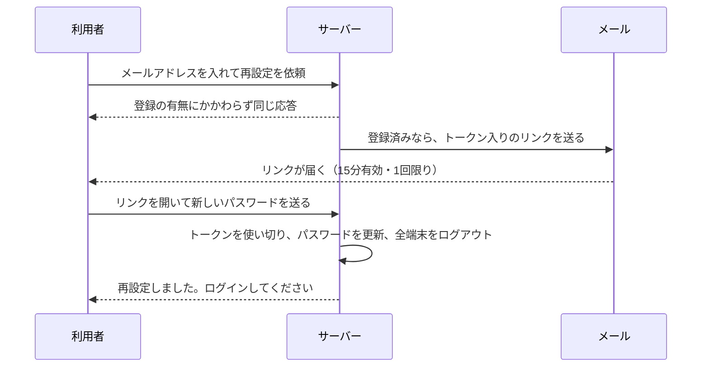
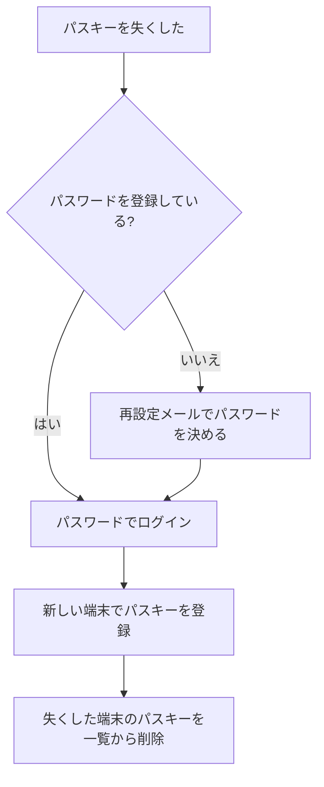

# 08 パスワード忘れと回復

## 「認証」ではなく「回復」として扱う

パスワードを忘れた人のために、メールで再設定用のリンクを送る仕組みは、多くのサービスにあります。
このプロジェクトも同じ仕組みを持っていますが、1 つだけはっきり決めていることがあります。

> メールは**回復**（アカウントを取り戻す手段）にだけ使い、**認証**（ログイン）には使わない（S11）

メールが届いたことで分かるのは、「その受信箱を使える人だ」ということだけです。
受信箱は乗っ取られることがありますし、届くまでの経路が暗号化されているとも限りません。
NIST SP 800-63B-4 も、メールを認証の手段として認めていません（§3.1.3.1）。そこで、次のように線を引いています。

- 再設定のリンクでできるのは、**新しいパスワードを決めることだけ**
- 再設定が済んでも、**ログイン状態にはしない**。新しいパスワードで、あらためてログインしてもらう
- パスキーを追加する前の本人確認（06 章の再認証）にも、メールは使わない



## 再設定トークンの性質

リンクに入っている使い捨ての値を、**再設定トークン**（パスワードを決め直す権利を表す、1 回限りの乱数）と呼びます。
持っていればパスワードを変えられる秘密なので、パスワードやセッション ID と同じように扱います（S10）。

| 性質 | 理由 |
|---|---|
| 256bit の乱数 | 推測で他人のリンクに当てられないように |
| 15 分で無効 | 受信箱に残ったリンクを後から悪用されにくいように |
| 1 回使ったら無効 | 盗み見たリンクを使い回されないように |
| DB には SHA-256 のハッシュだけ | トークンの表が漏れても、そこからリンクを作れないように |
| 新しいリンクを送ったら古いものは無効 | 有効なリンクが受信箱に何本も散らばらないように |

発行は `src/auth/reset.ts` の `issueResetToken` です。256bit の乱数は総当たりで元に戻せないので、パスワードのような遅いハッシュやソルトは要りません。

トークンはリンクの `?token=...` ではなく、`#` の後ろ（**フラグメント**）に置きます。
`?` の後ろはサーバーのアクセスログ（どの URL が開かれたかの記録）にそのまま残りますが、フラグメントはブラウザがサーバーへ送らない部分だからです。
画面の JavaScript がトークンを読み取ったら、アドレス欄からも消しています（`src/web/app.js` の `initResetNew`）。

## 使い切りを 1 文で行う

「トークンを探す → 未使用なら使用済みにする」を 2 つの SQL に分けると、同じリンクを同時に 2 回送られたときに、両方が通ってしまうことがあります。
そこで、条件付きの UPDATE（DB の行を書き換える命令）1 文で済ませています。

```ts
// 出典: src/db/repo/reset-tokens.ts:27-29
      `UPDATE reset_tokens SET used_at = ?
       WHERE token_hash = ? AND used_at IS NULL AND expires_at > ?
       RETURNING user_id`,
```

「未使用で期限内の行だけを使用済みにし、書き換えた行の持ち主を返す」という命令です。
SQLite は書き換えを 1 件ずつ順に処理するので、同時に送られても通るのは 1 回だけです。

## 依頼の受付: 登録の有無を明かさない

再設定の依頼（`POST /reset`）も列挙の入口になりえるので、登録の有無にかかわらず同じ応答を返します。

```ts
// 出典: src/routes/reset.ts:107-111
      // パスキーのみのユーザー（password_hash が NULL）にも送る。パスキーを失くしたときの回復手段がこれしかないため（§7-5）
      const rawToken = issueResetToken(app.db, user.id, now);
      audit(request, 'password.reset.request', user.id, { sent: true });
      sendLater(request, user.email, resetLink(app.config.origin, rawToken));
      return reply.send({ message: ACCEPTED_MESSAGE });
```

`sendLater` は、メールの送信を**応答を返した後**に回します。送信を待ってから応答すると、「登録済みは遅く、未登録は速い」という時間の差で分かってしまうからです。
同じ人に送る再設定メールは 15 分あたり 3 通までにし、他人の受信箱をメールで埋める嫌がらせを抑えています（S8）。

## 新しいパスワードの設定

```ts
// 出典: src/routes/reset.ts:145-157
      const outcome = app.db.transaction(() => {
        const userId = consumeResetToken(app.db, request.body.token, now); // S10: 使い切り・期限
        if (userId === undefined) return undefined;
        updatePasswordHash(app.db, userId, passwordHash);
        // 同じ人に送った他のリンクも使えなくする。受信箱に残った古いリンクで、決めたばかりのパスワードを上書きされないように
        invalidateResetTokensOfUser(app.db, userId, now);
        // …（略）
        const sessionsEnded = deleteSessionsOfUser(app.db, userId);
        return { userId, sessionsEnded };
      })();
```

新しいパスワードにも登録と同じ規則（03 章）を当て、ハッシュ化を済ませてから、トークンの使い切り・パスワードの更新・ほかのリンクの無効化・
全端末のログアウトを 1 つのトランザクションで行います。途中で失敗して「トークンだけ使われた」状態を残さないためです。
パスワードを知った第三者がすでに入っていたかもしれないので、本人確認を済ませたセッションも含めて全端末をログアウトさせます。

## 回復の限界

再設定は、乗っ取りからの完全な回復を約束するものではありません。

- **受信箱が乗っ取られていれば**、攻撃者が再設定でアカウントを取れます。メールを回復に使う以上、避けられない弱点です。
- **パスキーは再設定で消えません**。乗っ取られている間に攻撃者がパスキーを足していたら、そのパスキーで入り直せます。
  この見本では、パスキーの追加に直近 5 分以内の本人確認を求めるので（06 章）、盗んだ Cookie だけでは足せません。
  それでも、ログインや再認証の直後 5 分以内の Cookie を盗まれた場合は足されえます。これは受け入れたリスクです（09 章）。
  再設定のあとは、アカウント設定のパスキー一覧を開き、見覚えのないものを削除してください。

## パスキーを失くしたとき

05 章で触れたとおり、端末を失くしてパスキーが使えなくなったときも、この再設定が回復の手段になります。



## まとめ

- メールは回復専用。再設定が済んでもログイン状態にはしない
- 再設定トークンは 256bit・15 分・1 回限り・ハッシュ保存。リンクでは `#` の後ろに置く
- 使い切りは条件付きの UPDATE 1 文で行い、同時の二重使用を防ぐ
- 依頼の応答は、文言も時間も登録の有無で変えない
- パスキーは再設定で消えない。再設定のあとはパスキー一覧も確かめる
