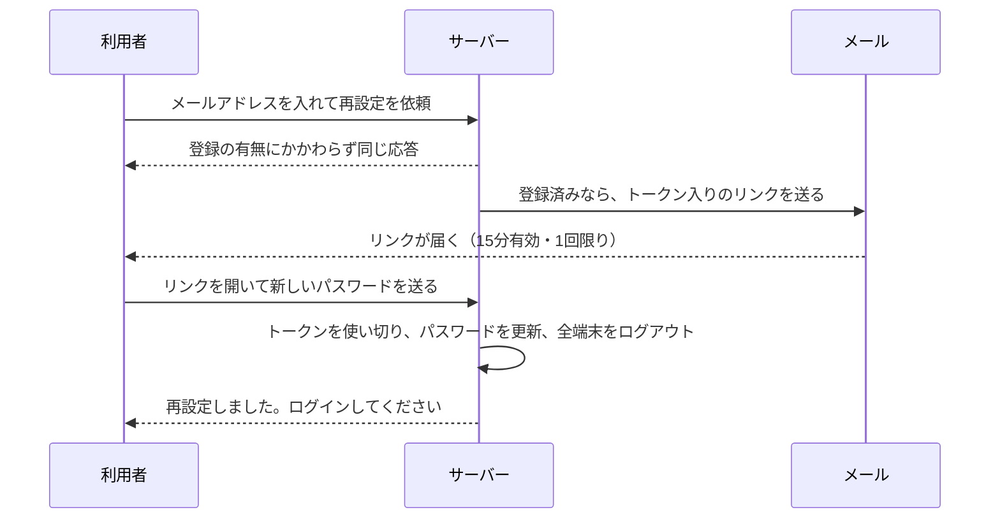
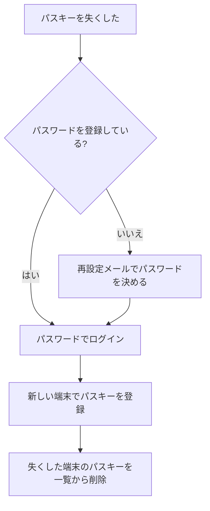

# 08 パスワード忘れと回復

## 「認証」ではなく「回復」として扱う

パスワードを忘れた人のために、メールで再設定用のリンクを送る仕組みは、多くのサービスにあります。
このプロジェクトも同じ仕組みを持っていますが、1 つだけはっきり決めていることがあります。

> メールは**回復**（アカウントを取り戻す手段）にだけ使い、**認証**（ログイン）には使わない（S11）

メールが届いたことで分かるのは、「その受信箱を使える人だ」ということだけです。
受信箱は乗っ取られることがありますし、メールが届くまでの経路が暗号化されているとも限りません。
「メールに届いたコードを入れたらログインできる」という作りは、本人確認として弱すぎます。
NIST SP 800-63B-4 も、メールを認証の手段として認めていません（§3.1.3.1）。

そこで、このプロジェクトでは次のように線を引いています。

- 再設定のリンクでできるのは、**新しいパスワードを決めることだけ**
- 再設定が済んでも、**ログイン状態にはしない**。新しいパスワードで、あらためてログインしてもらう



## 再設定トークンの性質

リンクに入っている使い捨ての値を、**再設定トークン**（パスワードを決め直す権利を表す、1 回限りの乱数）と呼びます。
このトークンも「持っていればパスワードを変えられる」秘密なので、パスワードやセッション ID と同じように扱います（S10）。

| 性質 | 理由 | 場所 |
|---|---|---|
| 256bit の乱数 | 推測で他人のリンクに当てられないように | `src/auth/reset.ts` |
| 15 分で無効 | 受信箱に残ったリンクを後から悪用されにくいように | `src/auth/reset.ts` |
| 1 回使ったら無効 | 盗み見たリンクを使い回されないように | `src/db/repo/reset-tokens.ts` |
| DB にはハッシュだけ | トークンの表が漏れても、そこからリンクを作れないように | `src/auth/reset.ts` |
| 新しいリンクを送ったら古いものは無効 | 有効なリンクが受信箱に何本も散らばらないように | `src/auth/reset.ts` |

発行のコードは次のとおりです。

```ts
// 出典: src/auth/reset.ts:42-51
export function issueResetToken(db: Db, userId: number, now: number): string {
  // S10: 256bit の乱数。推測で他人のリンクに当てることは現実的にできない
  const rawToken = randomBytes(32).toString('base64url');
  db.transaction(() => {
    invalidateResetTokensOfUser(db, userId, now);
    deleteStaleResetTokens(db, now - STALE_AFTER_MS);
    insertResetToken(db, { tokenHash: hashResetToken(rawToken), userId, expiresAt: now + RESET_TOKEN_TTL_MS });
  })();
  return rawToken;
}
```

DB に入るのは `hashResetToken(rawToken)`（SHA-256 というハッシュ）だけで、生のトークン `rawToken` はメールで送るためにだけ返されます。
セッション ID と同じく、256bit の乱数は総当たりで元に戻せないので、パスワードのような遅いハッシュやソルトは要りません。

### リンクの「#」の後ろに置く理由

```ts
// 出典: src/auth/reset.ts:62-69
/**
 * メールに載せるリンク。トークンは URL の「#」の後ろ（フラグメント）に置く。
 * フラグメントはブラウザがサーバーへ送らないので、トークンがアクセスログやリバースプロキシのログ、
 * Referer ヘッダに残らない（S12）。画面の JavaScript が読み取り、POST の本文で送る。
 */
export function resetLink(origin: string, rawToken: string): string {
  return `${origin}/reset/new#token=${rawToken}`;
}
```

URL の `?token=...` に置くと、サーバーのアクセスログ（どの URL が開かれたかの記録）に、トークンがそのまま残ります。
`#` の後ろ（**フラグメント**）はブラウザがサーバーへ送らない部分なので、ログに残りません。
画面の JavaScript がフラグメントからトークンを読み取ったら、アドレス欄からも消しています（`src/web/app.js` の `initResetNew`）。

## 使い切りを 1 文で行う

「トークンを探す → 未使用なら使用済みにする」を 2 つの SQL に分けると、同じリンクを同時に 2 回送られたときに、
両方が「未使用」と判定して通ってしまうことがあります。そこで、条件付きの UPDATE（DB の行を書き換える命令）1 文で済ませています。

```ts
// 出典: src/db/repo/reset-tokens.ts:24-33
export function consumeResetToken(db: Db, tokenHash: Buffer, now: number): number | undefined {
  return db
    .prepare(
      `UPDATE reset_tokens SET used_at = ?
       WHERE token_hash = ? AND used_at IS NULL AND expires_at > ?
       RETURNING user_id`,
    )
    .pluck()
    .get(now, tokenHash, now) as number | undefined;
}
```

「未使用（`used_at IS NULL`）で、期限内（`expires_at > ?`）の行だけを使用済みにし、書き換えた行の持ち主を返す」という命令です。
SQLite は書き換えを 1 件ずつ順に処理するので、同時に送られても、通るのは 1 回だけになります。

## 依頼の受付: 登録の有無を明かさない

再設定の依頼（`POST /reset`）も、ログインと同じく列挙の入口になりえます。
「そのメールアドレスは登録されていません」と返せば、登録の有無が分かってしまうからです。
そこで、登録の有無にかかわらず、同じ応答を返します。

```ts
// 出典: src/routes/reset.ts:107-111
      // パスキーのみのユーザー（password_hash が NULL）にも送る。パスキーを失くしたときの回復手段がこれしかないため（§7-5）
      const rawToken = issueResetToken(app.db, user.id, now);
      audit(request, 'password.reset.request', user.id, { sent: true });
      sendLater(request, user.email, resetLink(app.config.origin, rawToken));
      return reply.send({ message: ACCEPTED_MESSAGE });
```

`sendLater` は、メールの送信を**応答を返した後**に回しています。送信の完了を待ってから応答すると、
「登録済み（送信あり）は遅く、未登録（送信なし）は速い」という時間の差で、登録の有無が分かってしまうからです。
同じ人に送る再設定メールは 15 分あたり 3 通までにしています。第三者が他人の受信箱をメールで埋める嫌がらせを抑えるためです（S8）。

## 新しいパスワードの設定

```ts
// 出典: src/routes/reset.ts:141-156
      // S1: ハッシュ化（時間がかかる）を先に済ませ、トークンの消費からパスワードの更新までを
      // 1 つのトランザクションにする。途中で失敗して「トークンだけ使われた」状態を残さないため
      const passwordHash = await hashPassword(request.body.password);
      const now = Date.now();
      const outcome = app.db.transaction(() => {
        const userId = consumeResetToken(app.db, request.body.token, now); // S10: 使い切り・期限
        if (userId === undefined) return undefined;
        updatePasswordHash(app.db, userId, passwordHash);
        // 同じ人に送った他のリンクも使えなくする。受信箱に残った古いリンクで、決めたばかりのパスワードを上書きされないように
        invalidateResetTokensOfUser(app.db, userId, now);
        // パスワードを知った第三者がすでに入っていたかもしれないので、全端末をログアウトさせる。
        // ただしパスキー（credentials）には触れない。乗っ取られている間に追加されたパスキーは残るので、
        // 再設定だけでは攻撃者を締め出せない場合がある（threat-model.md §4 の「残るリスク」、対策は §10 で判断待ち）
        const sessionsEnded = deleteSessionsOfUser(app.db, userId);
        return { userId, sessionsEnded };
      })();
```

新しいパスワードにも、登録と同じ規則（03 章の `checkNewPassword`）を当てています。
そのうえで、トークンの使い切り・パスワードの更新・ほかのリンクの無効化・全端末のログアウトを、1 つのトランザクションで行います。

## 回復の限界

コメントにも書いたとおり、再設定は「乗っ取りからの完全な回復」を約束するものではありません。

- **受信箱が乗っ取られていれば**、攻撃者が再設定でアカウントを取れます。メールを回復に使う以上、避けられない弱点です。
- **乗っ取られている間に攻撃者がパスキーを追加していたら**、再設定でセッションを消しても、そのパスキーは残ります。
  再設定のあとは、アカウント設定のパスキー一覧を開き、見覚えのないものを削除してください。
  パスキーの追加に再認証を求めるかどうかなどの対策は、判断待ちとして `docs/threat-model.md` §10 に残しています。

## パスキーを失くしたとき

05 章で触れたとおり、端末を失くしてパスキーが使えなくなったときも、この再設定が回復の手段になります。



## まとめ

- メールは回復専用。再設定が済んでもログイン状態にはしない
- 再設定トークンは 256bit・15 分・1 回限り・ハッシュ保存。リンクでは `#` の後ろに置く
- 使い切りは条件付きの UPDATE 1 文で行い、同時の二重使用を防ぐ
- 依頼の応答は、文言も時間も登録の有無で変えない
- 回復には限界がある。再設定のあとはパスキー一覧も確かめる
