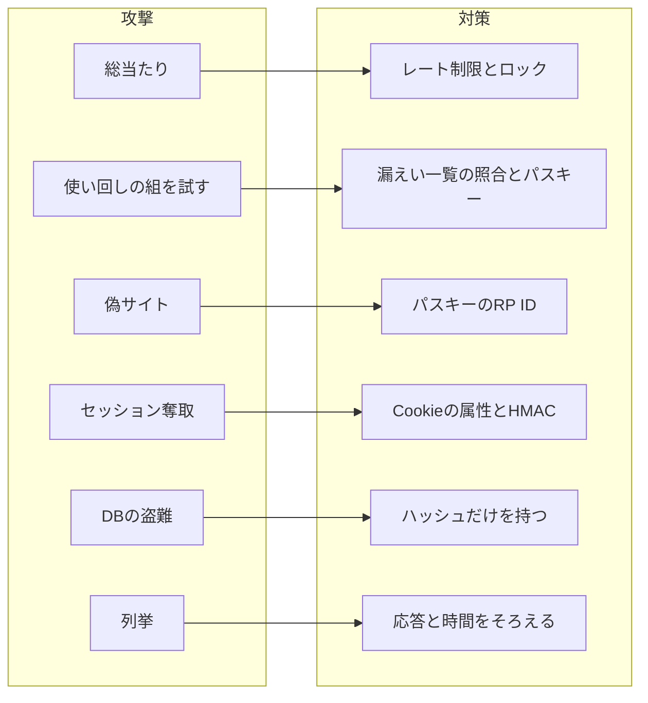

# 09 攻撃と防御

この章では、ここまでの章で出てきた対策を、**攻撃の側から**振り返ります。
「この攻撃は、どの仕組みの、どの行が防いでいるか」を一覧にしたものです。
より詳しい一覧（行番号つき）と、防ぎきれない「残るリスク」は `docs/threat-model.md` にあります。

## 攻撃者は何ができると考えるか

対策を考える前に、攻撃者が何をできると想定しているかを決めておきます。これを**脅威モデル**（どんな攻撃者が何をしてくるかの想定）と呼びます。

- インターネットから、好きな要求を好きなだけ送れる
- 本物そっくりの偽サイトを作れる
- どこかのサービスから漏れたメールアドレスとパスワードの組を持っている
- 場合によっては、このサービスの DB のコピーを盗み出せる

一方で、サーバーそのものの乗っ取りや、利用者の端末の乗っ取りは、この見本の範囲外としています。



## 1. 総当たり

**攻撃**: 1 つのアカウントに対して、パスワードを次々に試す。

| 対策 | 要件 | 章 |
|---|---|---|
| IP（要求の送り元の住所）ごとのレート制限（15 分あたり 30 回） | S8 | 06 |
| 5 回続けて失敗したら 15 分ロック。パスワードとパスキーの失敗を合わせて数える | S8, S9 | 07 |
| 判定と記録を照合の前に済ませ、同時の要求で上限をすり抜けさせない | S9 | 07 |
| 15 文字以上を求め、推測に必要な回数を大きくする | S2 | 03 |

IP ごとのレート制限は `@fastify/rate-limit` というライブラリに任せ、ログインや登録などのルートが個別に使います。

```ts
// 出典: src/server.ts:66-68
  // S8: IP ごとのレート制限。全体には掛けず、ログイン・登録などのルートが config.rateLimit で個別に使う
  const auth = options.authRateLimit ?? { max: 30, timeWindowMs: 15 * 60 * 1000 };
  app.decorate('authRateLimit', { max: auth.max, timeWindow: auth.timeWindowMs });
```

**残るリスク**: ロックは、メールアドレスを知っている第三者でも起こせます（利用者を 15 分ずつ締め出す嫌がらせ）。
また、多数の IP を使う分散型の総当たりは、IP の制限では止まらず、アカウント単位のロックで速度を落とすだけになります。

## 2. 資格情報の使い回し

**攻撃**: 他のサービスから漏れた「メールアドレスとパスワード」の組を、そのまま試す（クレデンシャルスタッフィング）。

| 対策 | 要件 | 章 |
|---|---|---|
| 登録・変更・再設定で、漏えい済みパスワードの一覧と照合して拒否する | S3 | 03 |
| 文字種や定期変更を強制しない（覚えられない規則は使い回しを増やす） | S2, S4 | 03 |
| パスキーを最初から選べる（パスキーには使い回せる秘密が無い） | S5 | 05 |

## 3. フィッシング

**攻撃**: 偽サイトに誘導して、パスワードやワンタイムコードを入力させて盗む。

| 対策 | 要件 | 章 |
|---|---|---|
| パスキーは RP ID でドメインに結びつく。認証器は偽サイトでは署名しない | S5 | 05 |
| サーバーも、署名がどのオリジンで作られたかを検証する | S5 | 05 |
| メールや SMS のコードをログインの要素にしない（コードは偽サイトに中継できる） | S11 | 08 |

サーバー側の検証では、期待するオリジンと RP ID を、ライブラリにそのまま渡しています。

```ts
// 出典: src/auth/passkey.ts:124-128
  return verifyAuthenticationResponse({
    response,
    expectedChallenge,
    expectedOrigin: config.origin,
    expectedRPID: config.rpId,
```

**残るリスク**: パスワードは、偽サイトに入力した時点で盗まれます。仕組みとしての根本対策は、パスキーへの移行です。

## 4. セッション奪取

**攻撃**: ログイン状態の Cookie を、盗む・推測する・前もって仕込む・他サイトから使わせる。

| 攻撃の形 | 対策 | 要件 | 章 |
|---|---|---|---|
| 推測 | セッション ID は 256bit の乱数 | S7 | 04 |
| XSS で Cookie を読む | HttpOnly。利用者が付けた名前は `textContent` で表示する | S7 | 04 |
| 通信の盗聴 | 本番は Secure と `__Host-` 接頭辞 | S7 | 04 |
| DB の盗難 | DB には ID の HMAC だけを保存する | S7 | 04 |
| セッション固定 | ログインのたびに新しい ID を発行する | S7 | 04 |
| CSRF | SameSite=Lax と、Origin ヘッダの検証を全ルートに掛ける | S13 | 04 |
| ログから拾う | ログに出す Cookie ヘッダを伏せる | S12 | このあと |

Origin の検証は、ルートごとではなく、アプリ全体に 1 か所で掛けています。

```ts
// 出典: src/server.ts:79-80
  // S13: 状態を変える要求は Origin ヘッダを検証する。全ルートに一度で掛け、付け忘れを無くす
  app.addHook('onRequest', verifyOrigin);
```

**残るリスク**: 盗んだセッションの間に、攻撃者が自分の認証器をパスキーとして追加できます。
パスワード変更や再設定をしてもパスキーは残るので、利用者がパスキー一覧で見覚えのないものを削除する必要があります。
パスキーの追加に再認証を求めるかどうかは、判断待ちです（`docs/threat-model.md` §10）。

## 5. DB の盗難

**攻撃**: DB のファイルを盗み、中身からパスワードや有効なセッションを取り出す。

| 値 | 持ち方 | 要件 | 章 |
|---|---|---|---|
| パスワード | Argon2id + 利用者ごとのソルト | S1 | 02 |
| セッション ID | HMAC-SHA256（鍵は DB の外） | S7 | 04 |
| 再設定トークン | SHA-256 | S10 | 08 |
| パスキー | 公開鍵だけ | S5 | 05 |

どれも「盗まれた値をそのまま送ってもログインできない」形です。00 章の設計原則「漏れても使えないものだけを持つ」は、この表のことです。

## 6. 列挙

**攻撃**: 応答の違いや時間の違いから、あるメールアドレスが登録済みかを調べる。

| 経路 | 対策 | 章 |
|---|---|---|
| ログイン | 文言と状態コードをそろえ、未登録でもダミーのハッシュと照合して時間をそろえる | 07 |
| ロック | 未登録のメールアドレスにも同じ規則でロックを掛ける | 07 |
| パスワード再設定 | 登録の有無にかかわらず同じ応答。メールは応答の後に送る | 08 |
| パスキーのログイン | 開始のときに「このメールの鍵」を返さない（Discoverable Credential） | 05 |

**残るリスク**: 新規登録では、登録済みのメールアドレスに 409 を返すので、そこから列挙できます。速度はレート制限で抑えています（06 章）。

## ログに秘密を残さない（S12）

監査ログは、あとから「いつ・誰が・どこから」を調べるためのものです。しかし、ログ自体が漏れることもあります。
そこで、ログにパスワード・セッション ID・再設定トークンの生値を書かないようにしています。

- 監査ログの `detail`（付け足す情報）は、型で「短い文字列・数値・真偽値」に絞っている（`src/db/repo/audit-log.ts`）
- アプリのログでは、Cookie と Authorization ヘッダを伏せている（`src/server.ts` の `redact`）
- テストで、すべての流れを通したあとに、最も詳しいレベルのログ・監査ログ・DB のどこにも生値が無いことを確かめている（`test/integration/audit.test.ts`）

## まとめ

- 対策は「攻撃 → 仕組み → 行」の順にたどれるようにしておく
- 1 つの対策に頼らず、レート制限とロック、SameSite と Origin のように重ねる
- 防ぎきれない「残るリスク」を書き出し、判断が必要なものは判断待ちとして残す
