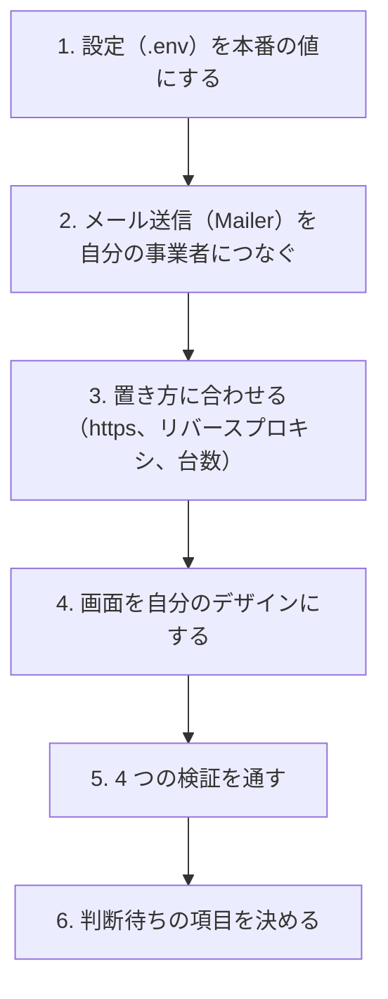

# 10 自分のサービスに組み込む

この見本は、受託案件や自社サービスの土台としてそのまま使えることを目指しています（MIT ライセンス）。
この章では、自分のサービスに組み込むときに**変えるもの**と**変えてはいけないもの**をまとめます。

## 全体の手順



## 1. 設定を本番の値にする

設定は環境変数（プログラムの外から渡す設定値）で渡します。`.env.example` を写して `.env` を作り、本番の値に書き換えます。
`.env` はリポジトリに入れないでください（`.gitignore` で除外しています）。

| 変数 | 本番での値 | 注意 |
|---|---|---|
| `NODE_ENV` | `production` | 本番の検査（下記）が有効になる |
| `ORIGIN` | `https://example.com` のような自分のオリジン | 末尾の `/` やパスを付けない |
| `RP_ID` | `example.com` のような自分のドメイン | `ORIGIN` のホスト名と同じか、その親ドメイン |
| `SESSION_SECRET` | 32 文字以上の乱数 | 漏れたら作り直す（全員がログアウトされる） |
| `DATABASE_PATH` | DB ファイルの置き場所 | バックアップを取る |

`RP_ID` は、一度パスキーを登録してもらったあとに変えると、**それまでのパスキーがすべて使えなくなります**（05 章）。最初に慎重に決めてください。

設定はサーバーの起動時に一度だけ検査し、誤りがあれば起動しません。たとえば本番で `ORIGIN` が https でなければ止まります。

```ts
// 出典: src/config.ts:80-90
    // WebAuthn の仕様上、RP ID はオリジンのホスト名そのものか、その親ドメインでなければならない。
    // ここで弾いておかないと、起動はできるのにパスキー登録だけが謎の失敗をする。
    const hostname = originUrl.hostname;
    if (hostname !== rpId && !hostname.endsWith(`.${rpId}`)) {
      problems.push(`RP_ID（${rpId}）は ORIGIN のホスト名（${hostname}）と同じか、その親ドメインにしてください`);
    }
    // パスキーは安全なコンテキスト（https、または localhost）でしか動かない。
    if (isProduction && originUrl.protocol !== 'https:') {
      problems.push('本番（NODE_ENV=production）では ORIGIN を https:// にしてください');
    }
  }
```

`SESSION_SECRET` は、次のコマンドで作れます（`.env.example` にも書いてあります）。

```bash
node -e "console.log(require('node:crypto').randomBytes(32).toString('base64url'))"
```

## 2. メール送信をつなぐ

開発中は、再設定メールを画面（ターミナル）に表示するだけの `ConsoleMailer` が使われます。
本番では、**自分のメール送信事業者につながる Mailer を渡さないと起動しません**。
黙ってコンソールに出し続けると、メールが誰にも届かないまま「送りました」と答え続けることになるからです。

Mailer は、次の 1 つの関数を持つだけの型です。

```ts
// 出典: src/mail/mailer.ts:11-13
export interface Mailer {
  send(to: string, subject: string, body: string): Promise<void>;
}
```

自分の事業者の SDK（その事業者のサービスを使うための部品）を使って、この型を実装します。たとえば次のような形です（事業者ごとに中身は変わります）。

```ts
import type { Mailer } from './mailer.js';

export class MyProviderMailer implements Mailer {
  async send(to: string, subject: string, body: string): Promise<void> {
    // ここで事業者の SDK を呼ぶ。API キーは環境変数から読み、コードに書かない。
    // 失敗したときに投げる例外の文やログに、body（再設定リンク＝トークンの生値）を含めないこと（S12）
  }
}
```

作った Mailer は、`src/server.ts` の起動処理で `buildApp` に渡します。

```ts
// 出典: src/server.ts:101-103
    config = loadConfig();
    // 本番で使うときは、ここで自分の送信事業者向けの Mailer を渡す: buildApp(config, { mailer })
    app = buildApp(config);
```

## 3. 置き方に合わせる

- **https で配信する**: パスキーも Secure 付きの Cookie も、https が前提です。
- **リバースプロキシ**（利用者とアプリの間に置いて、要求を中継するサーバー）の後ろに置く場合は、Fastify の `trustProxy` を設定してください。
  設定しないと、レート制限・ロック・監査ログに記録される IP が、すべてプロキシの IP になります。
- **複数台・複数プロセスで動かす場合**: レート制限の回数とパスキーのチャレンジは、今はプロセスのメモリに置いています。
  どのプロセスに要求が来ても同じ値を見られるよう、共有の置き場（DB や Redis など）に移す必要があります。
  Redis（レディス）は、メモリ上で動き、複数のサーバーから共有できる高速なデータの置き場です。

## 4. 画面を自分のデザインにする

`src/web/` の画面は、仕組みを読みやすくするために素の HTML にしています。自由に作り替えてかまいませんが、次の点は残してください。

- ログイン画面のメール欄の `autocomplete="username webauthn"`（条件付き UI、05 章）
- パスワード欄で貼り付けを禁止しない。`maxlength` を付けない（03 章）
- 利用者が入力した文字（パスキーの名前など）は `textContent` で表示する（`innerHTML` に入れると XSS になる）
- 再設定画面の `<meta name="referrer" content="no-referrer">` と、トークンをアドレス欄から消す処理（08 章）

## 変えてはいけないもの

次の性質は、どれも「漏れても使えない」「なりすまされない」を支えています。変えたくなったら、まず `docs/design.md` §6 と `docs/threat-model.md` を読み、
何が守られなくなるかを確かめてください。

| 変えてはいけないもの | 要件 | 章 |
|---|---|---|
| パスワードは Argon2id で保存する。平文や暗号化（元に戻せる形）にしない | S1 | 02 |
| 文字種の強制・定期変更の強制を足さない | S2, S4 | 03 |
| 漏えい一覧との照合を外さない | S3 | 03 |
| RP ID を固定し、パスキーの検証をライブラリに任せる | S5, S6 | 05 |
| セッション ID を DB にそのまま保存しない。Cookie の属性を外さない | S7 | 04 |
| ログイン・再設定のレート制限とロックを外さない | S8, S9 | 07 |
| 再設定トークンを長期・使い回し可能にしない | S10 | 08 |
| メールや SMS をログインの要素にしない | S11 | 08 |
| ログに秘密の生値を書かない | S12 | 09 |
| Origin の検証を外さない | S13 | 04 |
| 「存在しないメール」と「パスワード違い」の応答を分けない | — | 07 |

暗号に関わる処理（ハッシュ、署名の検証、乱数）を自前で書き直すのも避けてください。実績のあるライブラリに任せるほうが、誤りが入りにくくなります。

## 5. 4 つの検証を通す

変更したら、次の 4 つを必ず通してください。CI（GitHub に置いたとき、変更のたびに自動で検査する仕組み）も同じ 4 つを実行します。

```bash
npm run lint        # 書き方の検査
npm run typecheck   # 型の検査
npm test            # 単体・結合テスト（S1〜S13 の多くをここで確かめる）
npm run e2e         # ブラウザを動かすテスト。仮想の認証器でパスキーの登録とログインを試す
```

テストが落ちたときに、テストを飛ばして黙らせないでください。落ちたテストは、守られなくなった性質を教えてくれています。

## 6. 判断待ちの項目を決める

この見本には、サービスの性格によって答えが変わるため、決めずに残している項目があります（`docs/threat-model.md` §10）。

- 既存アカウントへのパスキー追加の前に、再認証（パスワードや既存のパスキーでの確認）を求めるか
- 新規登録で、確認メールを挟む方式にするか（列挙を防ぐため）
- パスキーのログインにも、アカウント単位のロックを掛け続けるか
- ログイン試行の記録と監査ログを、どれだけの期間残すか
- 監査ログを改ざんから守る仕組み（追記専用の外部保存など）を入れるか

扱う情報の重さや利用者の数に合わせて、組み込む側で決めてください。

## おわりに

ログインの仕組みは、「本人を通す」ことよりも「本人以外を通さない」「漏れても使えない」ことのほうに多くの工夫が要ります。
この解説が、その工夫の 1 つ 1 つに理由があることを伝えられていれば幸いです。
